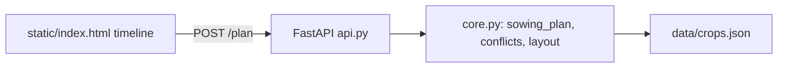

# Garden Planting Calendar ("Sow Calendar")

Enter your frost dates, get a full season of sowings and a bed layout.


## Problem
Seed packets say "sow 4 weeks before last frost", but a real plan needs repeat sowings, a hard stop before autumn frost or summer heat, and beds where crops that dislike each other are kept apart.

## Solution
A rule-based planner: every crop gets a first sowing at its offset from the last frost, then succession sowings at its interval; a sowing is dropped if it cannot be harvested before first frost (or before hot weather for cool-season crops). Crops are then assigned to beds, never mixing enemy pairs and grouping companions.

## Architecture


## Setup
```bash
pip install -r requirements-dev.txt
PYTHONPATH=src uvicorn gardenplan.api:app --reload   # http://localhost:8000
pytest -q && ruff check .
docker build -t gardenplan . && docker run -p 8000:8000 gardenplan
```
Endpoints: `GET /health`, `GET /crops`, `POST /plan`. Deploy: [DEPLOY.md](DEPLOY.md).

## Design decisions
- Rules, not ML: planting calendars are deterministic agronomy rules, so a model would be less explainable and no more accurate.
- Frost dates are user inputs: they differ per garden and a lookup table would be wrong for most users.
- Greedy bed assignment sorted by most enemies first: the hardest crops get placed while beds are still empty.
- Crop data in a JSON file: gardeners can add crops without touching code.
- Stateless API, no accounts: nothing personal is stored.

## Limitations
- 10 sample crops with approximate values; not agronomic advice.
- Heat cutoff is a single date input, no weather data.
- Beds are unordered groups (no rotation across years or physical sizes).

## Data
`data/crops.json` is synthetic, hand-written approximations; MIT with the repo.
