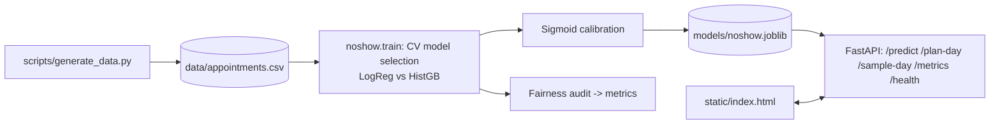

# Clinic No-Show Predictor


Predict which appointments will be missed, choose the right follow-up, and estimate how many slots to double-book.


## Problem
Missed appointments waste clinician time and delay care for other patients; typical outpatient no-show rates are 15–30%. Clinics usually either ignore the problem or overbook blindly.

## Solution
A calibrated classifier scores each appointment with a **no-show probability**, maps it to a **risk band and action** (standard reminder / extra SMS / phone call + double-book candidate), and a **day planner** ranks the schedule and sums the probabilities into *expected no-shows* with a conservative overbooking suggestion. A **fairness audit** (flag rate, base rate, AUC by age band and insurance type) is computed at training time and exposed at `/metrics`.

Held-out results (synthetic data, 25% test split, base rate 23%): ROC-AUC **0.75**, Brier **0.146** vs 0.179 for a base-rate predictor.

## Architecture

```
src/noshow/  model.py (selection, calibration, audit, planning) · train.py · api.py
tests/       14 tests: model logic, calibration, planning, fairness, API
```

## Setup
```bash
python -m venv .venv && source .venv/bin/activate
pip install -r requirements-dev.txt
python scripts/generate_data.py            # regenerates data/appointments.csv (already committed)
PYTHONPATH=src python -m noshow.train
PYTHONPATH=src uvicorn noshow.api:app --reload    # http://localhost:8000, API docs at /docs
pytest -q && ruff check .
```
Docker: `docker build -t clinic-noshow . && docker run --rm -p 8000:8000 clinic-noshow`. Deploy: [DEPLOY.md](DEPLOY.md).

```bash
curl -s localhost:8000/predict -H 'content-type: application/json' -d '{"age":22,"lead_days":30,"prior_visits":4,
 "prior_noshows":2,"hour":8,"weekday":0,"reminder_sent":0,"distance_km":15,"insurance":"public"}'
```

## Design decisions
- **Compare logistic regression and gradient boosting by 4-fold CV AUC, keep the winner** — a simple model often wins on small tabular data and is easier to defend; the selection is automatic and recorded in metrics.
- **Probability calibration (Platt/sigmoid)** — the planner sums probabilities, so they must be honest; isotonic was tried first and produced hard 0/1 outputs at the extremes.
- **Metrics include Brier score vs a base-rate baseline** — shows the model adds value beyond the average rate, not just ranking quality.
- **Risk bands drive concrete actions** — a score is only useful if it changes what staff do.
- **Overbook = floor(50% × expected no-shows)** — deliberately conservative to limit patient pile-ups; the share is a parameter.
- **Fairness audit built in** — scheduling models can disadvantage groups; flag rate and AUC per group are visible at `/metrics`. Note the flag rate is higher for under-25s and uninsured patients, mirroring the (synthetic) base rates; in production this would need clinical and ethical review, and the model should trigger *supportive* actions (reminders, easier rescheduling), never denial of care.
- **Day-sheet timetable UI, no framework** — staff think in hours and slots, so risk is shown on the schedule itself; visual system dealt with the taste-skill kit (palette "linen-harbour", Albert Sans).
- **Strict request validation (pydantic ranges, enum insurance)** — rejects bad input at the edge.
- **Data generated by a seeded logistic simulator** — no patient data, reproducible, with known ground-truth drivers.

## Dataset
Synthetic (6,000 appointments, seed 7), generated by `scripts/generate_data.py`; no real patient data; CC0. Features: age, lead days, prior visits/no-shows, hour, weekday, reminder sent, distance, insurance.

## Limitations
- Synthetic data: metrics show the pipeline works, not real-world performance; retrain on real (de-identified, consented) records.
- Missing signals real clinics have: appointment type, weather, transport, patient-reported barriers.
- Overbooking guidance ignores per-slot duration and provider capacity.
- Not a medical device; intended for administrative scheduling only.

## License
MIT.
