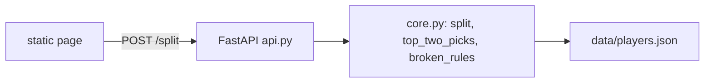

# Fair Teams Picker


## Problem
Picking sides for five-a-side by taking turns, best player first, tends to leave one team stronger, and it ignores "these two always argue" or "these two come as a pair".

## Solution
Search every equal-size split (team A always contains the first name alphabetically, so mirrored splits are not repeated), discard those that break the pair rules, and keep the one with the smallest total-skill gap. Sample (10 invented players, skills 1-10; keep Aiden and Bea apart, keep Gus and Hope together): the best split has a gap of 1 (28 v 27, the minimum possible since the total is odd). Captains picking in turn gives a gap of 5 and separates Gus and Hope. Tests compare against an independent brute force.

## Architecture


## Setup
```bash
pip install -r requirements-dev.txt
PYTHONPATH=src uvicorn teampick.api:app --port 8000
PYTHONPATH=src pytest
docker build -t teampick . && docker run -p 8000:8000 teampick
```
Deploy: see [DEPLOY.md](DEPLOY.md) (Render or Hugging Face Spaces).

## Design decisions
- Exhaustive search: with at most 16 players that is 6,435 splits, so the answer is provably optimal.
- Rules as hard constraints, not penalties: a "keep apart" pair is never broken.
- Deterministic tie-break (smallest skill gap, then the earliest team A): the same input always gives the same teams.
- Capped at 16 players: keeps response time predictable; larger groups would need a heuristic.

## Limitations
- One skill number per player; no positions or stamina.
- Even player counts and exactly two teams only.
- Players and ratings are invented.

Data: invented, MIT licence.
