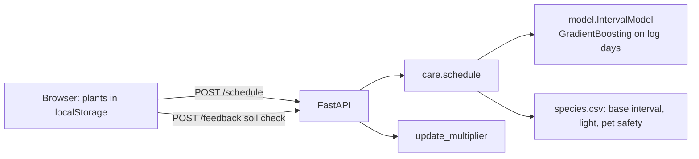

# Plant Parent


"Water every Sunday" is wrong for most houseplants. A snake plant in a terracotta pot by a bright window and a fern in a plastic pot in the bathroom do not dry out at the same speed, and neither does the same plant in January and July. Plant Parent predicts when each plant is actually due, and learns from how the soil feels when you check it.


## A day with it
1. **Open the page.** The headline says how many plants need water today; the list below shows each plant's interval, a tolerance (for example "every 7.9 days, ±1") and a pet-toxicity warning if you have pets.
2. **Water a plant and tap "Watered".** It asks how the soil was: *bone dry*, *slightly dry* or *still wet*.
3. **The schedule adapts.** Bone dry shortens that plant's interval by 10%, still wet lengthens it by 15% (bounded between half and double the model's estimate). Slightly dry leaves it alone.
4. **Look at the month calendar** to plan travel or ask a neighbour to help.

Your plant list is stored in your own browser (`localStorage`). The server is stateless: it receives the plants with each request and returns the schedule.

## How it works

- **Species catalogue** gives a base interval, light need and pet safety.
- **The model** adjusts that base for pot width, pot material, light, season, room temperature and humidity.
- **A per-plant multiplier** learned from soil checks personalises the result.
- **A measured uncertainty band** (the 80th percentile of the model's relative error) is shown as the ± window.

| Check (1,000 held-out synthetic observations) | Result |
|---|---|
| Model error (MAE) | 1.2 days |
| Species-only baseline error | 3.9 days |
| 80% of predictions within | about 17% of the true interval |
| Tests | 22 passing |

## Run it
```bash
python -m venv .venv && source .venv/bin/activate && pip install -r requirements-dev.txt
python scripts/generate_data.py                  # species + observations (already committed)
PYTHONPATH=src python -m plantparent.train
PYTHONPATH=src uvicorn plantparent.api:app       # http://localhost:8000, docs at /docs
pytest -q && ruff check .
```
Docker: `docker build -t plant-parent . && docker run --rm -p 8000:8000 plant-parent`. Hosting: [DEPLOY.md](DEPLOY.md).

## Design decisions
- **Learn a correction on top of a species baseline** — the catalogue is human-readable and the model only learns how conditions stretch or shrink it, which needs far less data than learning species from scratch.
- **Predict log(days)** — drying times are multiplicative (a bigger pot, winter and low light all multiply), so the log target is simpler and keeps predictions positive.
- **Soil-check feedback as a bounded multiplier, not retraining** — instant, explainable ("you said it was dry twice, so I shortened it"), and cannot run away because it is clamped to 0.5x to 2x.
- **Show a ± window from measured error** — a schedule that pretends to be exact teaches people to distrust it; the window is the model's real 80th-percentile error.
- **Stateless server, data in the browser** — no accounts, nothing to leak, and any free host can run it.
- **Pet warnings only when you say you have pets** — useful without nagging.
- **Season from the date, flipped for the southern hemisphere** — a default that is right for half the world would be wrong for the other half.
- **Visual system dealt with taste-skill**: palette "cobalt-on-sand" (two-tone, with a night set), Besley + Albert Sans, a today checklist beside a month calendar.

## Dataset
`data/species.csv` (24 common houseplants with illustrative care values, compiled for this demo) and `data/observations.csv` (4,000 synthetic watering observations from a simple drying model with noise), both generated by `scripts/generate_data.py` (seed 13). No real users. CC0. Care values are illustrative, not horticultural advice.

## Limitations
- The observations are simulated, so error numbers show the pipeline works, not real-world accuracy; a deployment should collect real soil checks.
- No growth tracking: a plant that outgrows its pot needs its pot width updated by hand.
- No reminders or notifications; it is a page you open.
- 24 species only; unknown plants cannot be scheduled yet.

## License
MIT.
