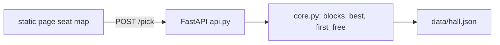

# Cinema Seat Picker


## Problem
Booking for a group means finding several free seats side by side in a good spot, and "first free" tends to put you in the front corner.

## Solution
List every run of N free seats in one row, score each by how far its centre is from the ideal spot (centred, two-thirds of the way back) and pick the lowest score. Sample (invented 7 x 10 hall, party of 3): row 5, seats 4-6 (score 0.5); the first-free baseline would pick the front-left corner (score 9.5).

## Architecture


## Setup
```bash
pip install -r requirements-dev.txt
PYTHONPATH=src uvicorn seatpick.api:app --port 8000
PYTHONPATH=src pytest
docker build -t seatpick . && docker run -p 8000:8000 seatpick
```
Deploy: see [DEPLOY.md](DEPLOY.md) (Render or Hugging Face Spaces).

## Design decisions
- Exhaustive scan of blocks: halls are small, so it is exact and simple.
- Ideal spot at two-thirds back, centred: the usual advice for cinema seating.
- Row distance weighted 1.5x seat distance: sitting far off the middle row is worse than a few seats sideways.
- Ties go to the lower row then the left seat: deterministic output.
- Plain-text seat map (`X` taken, `.` free): easy to write tests and to extend.

## Limitations
- Seats must be side by side in one row; no split parties across rows.
- No aisle gaps, wheelchair spaces or distancing rules.
- The hall and bookings are invented.

Data: invented, MIT licence.
