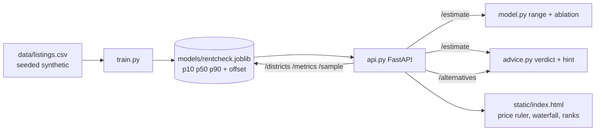

# Rent Check

Most renters have no idea whether the number on the lease is fair, and landlords know it. Rent Check takes the details of one flat and answers three plain questions: what should it cost (a range, not a single guess), is my rent above or below that, and which features are pushing the price. It also shows cheaper, similar flats in other districts and gives you a sentence to use when you negotiate. The demo runs on **Marlowe**, a made-up city with 8 districts and 4,000 synthetic listings, so there is no real data anywhere.


## How it works

1. You enter a flat (district, size, rooms, floor, extras, distances, building age) and the rent you are asked to pay.
2. Three gradient boosting models (quantile loss at 10%, 50% and 90%) predict the low end, typical price and high end for that flat.
3. A small calibration step widens the band until about 80% of unseen rents fall inside it.
4. The page puts your rent on a price ruler and says fair, above market or below market, with the % difference to the typical price.
5. Each feature is swapped for the typical value in your district, one at a time. The change in the typical price is that feature's contribution in euros.
6. Similar listings in other districts that cost less are listed as alternatives.

## Metrics

Held-out test split (800 listings the models never saw; 2,400 train, 800 calibration).

| Metric | Value |
| --- | --- |
| MAE (typical price vs actual rent) | 69.59 EUR |
| MAPE | 8.04% |
| p10 to p90 interval coverage (target 80%) | 79.5% |
| Coverage before calibration | 69.5% |
| Rents below p10 / above p90 | 10.9% / 9.6% |
| Median band width | 206.65 EUR |

Live numbers: `GET /metrics`. Regenerate with `python -m rentcheck.train`.

## Architecture



Modules in `src/rentcheck/`: `config` (city and features), `data` (generator), `model` (quantile models, calibration, ablation), `advice` (verdict, hint, alternatives), `schemas` (validation), `train`, `api`.

## Run it

```bash
python -m venv .venv && . .venv/bin/activate
pip install -r requirements-dev.txt
export PYTHONPATH=src
python -m rentcheck.train                 # optional, the API trains on first start if missing
uvicorn rentcheck.api:app --port 8000     # open http://localhost:8000
pytest -q && ruff check .
```

Docker: `docker build -t rent-check . && docker run --rm -p 8000:8000 rent-check`.

Endpoints: `GET /health`, `GET /metrics`, `GET /districts`, `GET /sample`, `POST /estimate`, `POST /alternatives` (same JSON body as `/sample`), interactive docs at `/docs`.

## Design decisions

- Visual system dealt with taste-skill: palette card-pastels, type zilla (Zilla Slab headings, Rethink Sans text), round radius. Pink accent on warm off-white with pastel cards keeps it friendly for a stressful topic.
- A price ruler is the hero because a range plus a marker is understood faster than a table of numbers.
- The verdict sentence is the largest text on the page so the answer comes before any detail.
- Models are fitted on log(rent) so effects are proportional (a balcony costs more in a big flat) and predictions stay positive.
- Three separate quantile models instead of one point model plus a fixed margin, so uncertainty differs per flat.
- Split-conformal widening on a separate calibration set, because raw quantile models under-covered (69.5% vs 80%).
- Quantile crossing is repaired by sorting the three predictions so p10 <= p50 <= p90 always holds.
- Contributions use one-at-a-time ablation against the district-typical flat: simple to explain, and the leftover is shown as "smaller effects together" so the bars add up.
- Verdict is fair within 10% of the typical price and inside the band; this avoids calling a 2% difference a rip-off.
- Alternatives require the same bedroom count and similar size, so savings are not just a smaller flat.
- No JavaScript framework: one static page, no build step, and it works at 320px width.
- Motion is one entrance on load, 2px hover lift in 150ms, and is switched off under prefers-reduced-motion.

## Dataset

`data/listings.csv`: 4,000 rows, generated by `scripts/generate_data.py` (seed 42, `rentcheck.data`). Rent is size times a district price per m2 (smaller flats cost more per m2), times effects for floor and lift, furnished, balcony, bathrooms, pets, building age and distances, with 7.5% log-normal noise. Released under CC0. No real listings, people or addresses.

## Limitations

- The data is synthetic: the model learns the generator's rules, not a real market. Real use needs real listings and local checks.
- One city, one point in time, no seasonality, condition, noise or view.
- Rent is rounded to 5 EUR; intervals are marginal, not guaranteed for unusual flats outside the training range.
- Contributions are approximate and ignore interactions (shown separately as the remainder).
- Not financial or legal advice.

## Deploy

See [DEPLOY.md](DEPLOY.md) for Render (`render.yaml`) and Hugging Face Spaces. MIT licensed.
