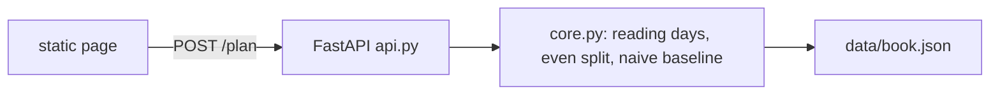

# Reading Pace Planner


## Problem
You want to finish a book by a date, but you do not read on some weekdays. Dividing the pages by calendar days gives a daily target that falls short.

## Solution
Count the actual reading days (skipping chosen rest weekdays), divide the pages left across them and give the leftover pages to the earliest days, so no two days differ by more than one page. Sample (640 pages, 40 already read, 16 Nov to 13 Dec 2026, weekends off):

| Plan | Pages a day | Pages reached |
|---|---|---|
| Reading-day plan | 30 on each of 20 days | 600 of 600 |
| Divide by calendar days (28) | 22 | 440 of 600 |

## Architecture


## Setup
```bash
pip install -r requirements-dev.txt
PYTHONPATH=src uvicorn readpace.api:app --port 8000
PYTHONPATH=src pytest
docker build -t readpace . && docker run -p 8000:8000 readpace
```
Deploy: see [DEPLOY.md](DEPLOY.md) (Render or Hugging Face Spaces).

## Design decisions
- Spread leftovers over the earliest days: you finish early rather than cramming at the end.
- Rest weekdays are inputs: a fixed "weekends off" rule suits fewer people.
- Dates validated within two years: stops typos like 2062.
- Stateless API, invented book: nothing personal stored.

## Limitations
- Assumes you read on every non-rest day; no catch-up if you miss one (re-run with pages already read).
- Pages are not words: dense pages take longer.
- No holidays calendar.

Data: invented, MIT licence.
