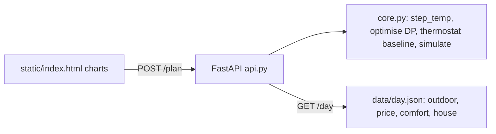

# Heating Schedule Optimiser ("Warm Hours")

Pick the cheapest hours to run the heater so the home is warm when people are in, using a simple thermal model and exact dynamic programming.


## Problem
A normal thermostat holds one temperature all day: it heats at expensive peak hours, cannot pre-heat for the morning, and overshoots when nobody cares. With time-of-use power prices, when you heat matters as much as how much.

## Solution
Model the house as a first-order system: each hour the indoor temperature drops by `loss x (indoor - outdoor)` and rises by a fixed gain when the heater is on. A dynamic programme over (hour, temperature rounded to 0.1 C) chooses heater on/off each hour to minimise energy cost plus a penalty for being below the comfort target while home (and a small one for overheating). On the two-day sample: energy cost 12.12 vs 13.98 for a plain 20.5 C thermostat (13% less, 63 vs 69 kWh), with 0.17 vs 3.21 cold degree-hours and 0.07 vs 3.38 overheat degree-hours.

## Architecture


## Setup
```bash
pip install -r requirements-dev.txt
PYTHONPATH=src uvicorn heatplan.api:app --reload   # http://localhost:8000
pytest -q && ruff check .
docker build -t heatplan . && docker run -p 8000:8000 heatplan
```
Endpoints: `GET /health`, `GET /day`, `POST /plan` (start temperature, comfort target, thermostat setpoint). Deploy: [DEPLOY.md](DEPLOY.md).

## Design decisions
- Dynamic programming over snapped temperatures instead of a heuristic: the optimum is guaranteed for the model, and the state space (a few hundred temperatures x 48 hours) is tiny.
- Brute-force check on 9-hour problems in the tests: proves the DP is optimal up to the 0.1 C snapping, rather than just plausible.
- Penalise both cold and overheating: with only a cold penalty the optimiser pre-heated to 25 C, which a real household would not accept.
- Compare against a hysteresis thermostat, not "no control": the honest baseline for what people already have.
- Stateless API, synthetic day and tariff: no accounts, no real meter data.

## Limitations
- First-order model with one heat capacity: no wind, sun, thermal mass of walls, or humidity.
- Heater is on/off per hour (fixed output); real heat pumps modulate and their efficiency depends on outdoor temperature.
- 13% saving is for this synthetic tariff; a flat tariff leaves little to optimise.

## Data
`data/day.json`: invented winter temperatures, tariff and house parameters; MIT with the repo.
