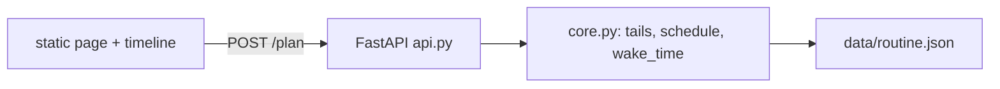

# Morning Routine Planner


## Problem
"I need 53 minutes to get ready" is wrong when the kettle boils while you shower, but equally wrong if you assume you can shower and eat at the same time. The real question is the latest wake-up time that still gets you out the door.

## Solution
Model the routine as tasks with durations and "must come after" links. Hands-free tasks (kettle, toaster) run on their own; the rest are done one at a time, and whenever you are free you take the ready task with the longest chain of work still behind it (a list-scheduling rule). Sample (invented routine, leave 08:15): 44 minutes start to door, so wake at 07:31, against 07:22 if everything were done one by one. The dependency chain alone is 25 minutes, which is a lower bound with unlimited helpers.

## Architecture


## Setup
```bash
pip install -r requirements-dev.txt
PYTHONPATH=src uvicorn morningplan.api:app --port 8000
PYTHONPATH=src pytest
docker build -t morningplan . && docker run -p 8000:8000 morningplan
```
Deploy: see [DEPLOY.md](DEPLOY.md) (Render or Hugging Face Spaces).

## Design decisions
- Hands-free versus hands-on tasks: a person cannot shower and eat together, so only tasks that run themselves overlap.
- Longest-remaining-chain priority: a standard, explainable rule for scheduling dependent tasks.
- Loop detection with a clear error: two tasks waiting for each other would otherwise hang the search.
- Lower bound reported next to the result: shows how close the plan is to the best that could ever be done.
- Greedy, so not proven optimal in general; it matches brute force on the sample, which is tested.

## Limitations
- One person only; no travel time or traffic.
- Task lengths are fixed estimates.
- Routine and times are invented.

Data: invented, MIT licence.
