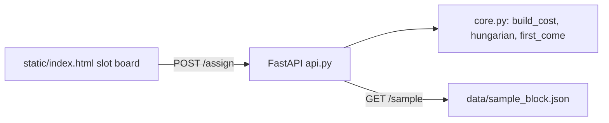

# Laundry Slot Scheduler ("Wash Rota")

Fair slot assignment for one shared washing machine in an apartment block, solved exactly with the Hungarian algorithm.


## Problem
Ten flats, one machine and twelve weekly slots. "First come, first served" lets early posters grab contested slots and leaves a flat that only wanted Saturday morning with nothing.

## Solution
Every resident ranks acceptable slots. The cost of a slot is its rank (0 = best); a slot outside the list costs 10. Residents and slots form a square cost matrix (spare slots absorbed by dummy residents) and the Hungarian algorithm finds the minimum-total-cost one-slot-each assignment. Sample block: total cost 14 against 23 for first-come, and one resident with no listed slot instead of two (four flats compete for Saturday morning, so someone must lose).

## Architecture


## Setup
```bash
pip install -r requirements-dev.txt
PYTHONPATH=src uvicorn washrota.api:app --reload   # http://localhost:8000
pytest -q && ruff check .
docker build -t washrota . && docker run -p 8000:8000 washrota
```
Endpoints: `GET /health`, `GET /sample`, `POST /assign`. Deploy: [DEPLOY.md](DEPLOY.md).

## Design decisions
- Hungarian algorithm instead of greedy: it is exact in O(n^3), and greedy loses on contested slots (shown by a test).
- Rank as cost, fixed penalty for unlisted slots: simple and explainable; the penalty only matters when nothing listed is left.
- Dummy residents for spare slots: keeps the matrix square without special cases.
- Tested against brute-force permutations on 80 random matrices: proves optimality rather than validity.
- Stateless API with synthetic data: no accounts or personal details needed.

## Limitations
- One slot per resident per run; no weekly fairness memory across runs (a resident who lost this week is not favoured next week).
- Minimises total cost, so one resident may absorb the whole loss (no max-min fairness).
- Slots are labels, not real calendar times.

## Data
`data/sample_block.json`: synthetic flats and slots; MIT with the repo.
