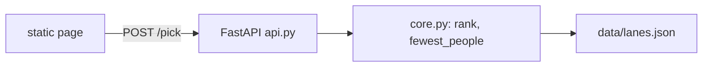

# Checkout Line Chooser


## Problem
At the supermarket the shortest queue is not always the fastest: a short line of full trolleys loses to a longer line of small baskets, and the express lane is closed to big baskets.

## Solution
Estimate the wait for each line as the time to serve everyone ahead plus my own basket (per-customer overhead plus seconds per item), skip lanes whose item limit I exceed, and rank the rest. Sample (invented speeds), 14 items:

| Lane | People ahead | My wait |
|---|---|---|
| Till B | 4 | 4m 25s |
| Self-service | 4 | 4m 58s |
| Till A | 2 | 5m 43s |
| Express | 2 | not allowed (limit 10) |

Joining the shortest queue (Till A) costs 1m 18s more than Till B.

## Architecture


## Setup
```bash
pip install -r requirements-dev.txt
PYTHONPATH=src uvicorn linepick.api:app --port 8000
PYTHONPATH=src pytest
docker build -t linepick . && docker run -p 8000:8000 linepick
```
Deploy: see [DEPLOY.md](DEPLOY.md) (Render or Hugging Face Spaces).

## Design decisions
- Wait = sum of serve times ahead plus mine: it is the simplest model that matches how a queue works.
- Items per person are an input: a count is visible from the queue, a time is not.
- Ineligible lanes are listed but never chosen: shows why Express is skipped.
- Ties go to the alphabetically first lane: deterministic output.
- Stateless API, invented data: nothing personal stored.

## Limitations
- Assumes constant speeds per lane; real cashiers vary and shoppers switch lines.
- Ignores people already being served part-way and queue changes while you wait.
- Speeds and queues are invented, not measured.

Data: invented, MIT licence.
