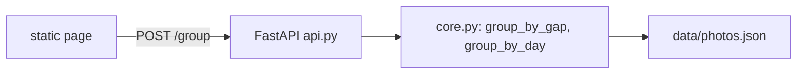

# Photo Album Grouper


## Problem
Phone photos arrive as one long stream. Grouping them by calendar day cuts a late-night party in two at midnight and merges nothing that really belongs together.

## Solution
Sort photos by timestamp and start a new album whenever the gap to the previous photo exceeds a threshold (default 4 hours). Sample (23 invented timestamps): 5 albums, including a birthday dinner from 19:05 to 01:05 kept as one album of 8. Calendar-day grouping gives 6 albums and splits that dinner into 5 + 3.

## Architecture


## Setup
```bash
pip install -r requirements-dev.txt
PYTHONPATH=src uvicorn albumgroup.api:app --port 8000
PYTHONPATH=src pytest
docker build -t albumgroup . && docker run -p 8000:8000 albumgroup
```
Deploy: see [DEPLOY.md](DEPLOY.md) (Render or Hugging Face Spaces).

## Design decisions
- Gap-based splitting (sessionization): the standard way to cluster events in time with one parameter.
- Gap must be strictly greater than the threshold: a photo exactly at the limit stays in the album.
- Input is sorted first: camera rolls are not guaranteed to be in order.
- Only timestamps are used: no image files are read, so nothing personal is processed.

## Limitations
- Ignores location, so two events in different places a few hours apart merge.
- One fixed gap; real events vary (a hike versus a dinner).
- Timestamps are naive local times, no time zones.

Data: invented, MIT licence.
