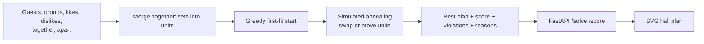

# Wedding Seating Planner


*Forty-eight guests, six tables of eight, two people who have not spoken since 2019, a grandmother who must sit with her two sisters, and a couple who cannot be separated.* This is the spreadsheet nightmare every couple has. The planner turns it into an optimisation problem and solves it in under a second.


## What you get
- A **seating plan** drawn as round tables, colour-coded by social group.
- A **happiness score** next to the score a random seating would get (about 33 against 162 for the sample party).
- **Hard rules that are never broken**: table size, "must sit together" groups, "must be apart" pairs.
- **Soft wishes that are maximised**: people who asked to sit together, friends from the same group, and a heavy penalty for people who clash.
- **Reasons per guest** ("Sana: both in Work"), and **click-to-swap** editing that re-scores the plan instantly and outlines any broken rule in red.

## Under the hood

1. Groups that must sit together are merged into **units** that always move as one, so they can never be split.
2. A first-fit-decreasing pass gives a valid start.
3. **Simulated annealing** proposes swaps and moves of units between tables. Only the two affected tables are re-scored. Worse moves are accepted with probability `exp(delta / temperature)` while the temperature cools, so the search escapes poor early arrangements.
4. The best plan seen is returned with per-table scores and a plain-language reason for each guest.

| Pair seated at the same table | Points |
|---|---|
| Asked to sit together | +8 |
| Same social group | +1 |
| Would rather not sit together | -12 |
| Must be apart (hard rule) | -1000 |

## Run it
```bash
python -m venv .venv && source .venv/bin/activate && pip install -r requirements-dev.txt
python scripts/generate_sample.py          # rebuilds data/sample_party.json (already committed)
PYTHONPATH=src uvicorn seating.api:app     # http://localhost:8000, docs at /docs
pytest -q && ruff check .
```
Docker: `docker build -t seating-planner . && docker run --rm -p 8000:8000 seating-planner`. Hosting: [DEPLOY.md](DEPLOY.md). No ML model and no external services, so the image is small and starts instantly.

```bash
curl -s localhost:8000/solve -H 'content-type: application/json' -d '{"table_size":2,
 "guests":[{"name":"A","group":"x"},{"name":"B","group":"x"},{"name":"C","group":"y"},{"name":"D","group":"y"}]}'
```

## Design decisions
- **Simulated annealing, not an exact solver** — seating is a graph-partitioning problem (NP-hard); annealing gives near-optimal plans for 200 guests in well under a second with no solver dependency.
- **Hard rules as constraints on moves and a -1000 penalty as a safety net** — together-groups are structural (units), apart-pairs are penalised so a plan that breaks one can never beat one that does not.
- **Seeded randomness** — the same seed gives the same plan (tested); "Find another plan" just changes the seed.
- **Only the two touched tables are re-scored per move** — keeps 20,000 iterations fast in pure Python.
- **A random-seating baseline in every answer** — shows the planner is better than not planning, with a number.
- **`/score` re-evaluates any manual arrangement** — the same function explains solver output and hand edits, so they cannot disagree.
- **Reasons come from the same affinity table as the score** — no separate explanation logic to drift.
- **Standard library only for the solver** — nothing to install or train; deterministic and easy to test.
- **Visual system dealt with taste-skill**: palette "warm-black-gold" (dark first, light set provided), Vollkorn + Work Sans, hall-plan canvas with an inspector panel.

## Dataset
`data/sample_party.json`: 48 invented guests in five groups, with 4 wishes, 2 clashes, 2 hard separations and 4 together-groups, generated by `scripts/generate_sample.py` (seed 3). No real people. CC0.

## Limitations
- Round tables only; no head table, no accessibility needs, no per-seat adjacency (who sits *next* to whom).
- Affinity weights are fixed; a UI to tune them would help.
- Annealing is heuristic: it can miss the global optimum, so try several seeds for a large party.
- Guest names must be unique; two guests with the same name need distinguishing.

## License
MIT.
