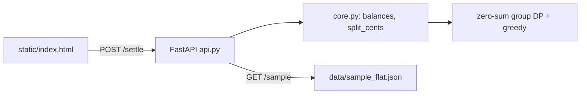

# Roommate Bill Settler ("Square Up")

Shared flat expenses in, the fewest possible payments out.


## Problem
Flatmates pay for rent top-ups, groceries and bills in turns. Repaying every bill separately means a web of small transfers (12 in the sample). Most apps just net balances greedily, which is not always the minimum.

## Solution
Compute each person's net balance in integer cents, then find the **minimum number of payments**: split people into the largest number of zero-sum groups (a group of k settles in k-1 payments) with a bitmask DP, then settle each group greedily. Sample flat: 3 payments instead of 12.

## Architecture


## Setup
```bash
pip install -r requirements-dev.txt
PYTHONPATH=src uvicorn settler.api:app --reload   # http://localhost:8000
pytest -q && ruff check .
docker build -t settler . && docker run -p 8000:8000 settler
```
Endpoints: `GET /health`, `GET /sample`, `POST /settle`. Deploy: see [DEPLOY.md](DEPLOY.md) (Render free tier, Docker).

## Design decisions
- Integer cents everywhere: floats would leave balances off by a cent; totals always balance exactly.
- Leftover cents of a split go to the first people in order: deterministic and sums exactly.
- Exact bitmask DP up to 14 people with non-zero balances: optimal and still instant (3^n subsets); beyond that fall back to greedy so the API cannot be stalled.
- Tests compare the solver against an independent brute force on random cases: proves optimality, not just validity.
- No database, stateless API: the browser holds the data, so there is nothing personal to store.

## Limitations
- Greedy (not optimal) above 14 people with open balances.
- Equal splits only; no custom weights or currencies.
- Fewest payments, not shortest-path through real bank fees.

## Data
`data/sample_flat.json` is synthetic (invented names and amounts), MIT licensed with the repo.
