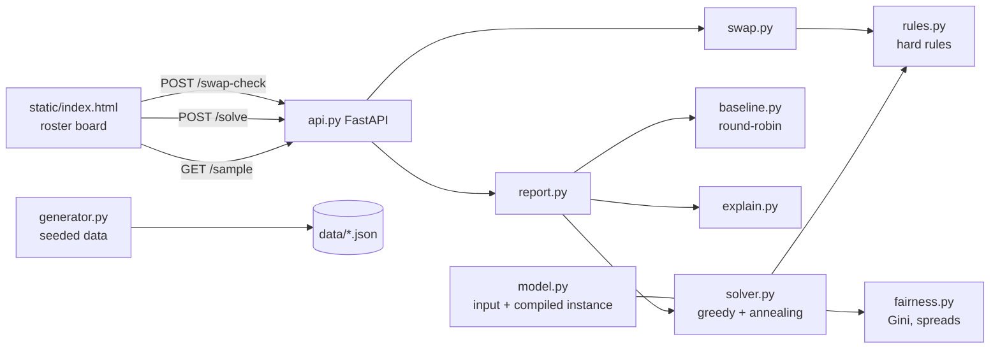

# Fair Shift Roster

**Monday 7:40.** Two people have called in sick, the clinic opens at 7:00, and next week's roster still has a hole on Sunday night. You also promised Bram he would get a weekend off, and Chen has been on mornings three weeks running. You do not want a spreadsheet; you want a roster that covers every shift, never breaks the rest rules, and that you can defend when someone asks "why me?".

Fair Shift Roster builds that roster for a 12-person clinic or shop (one week or four), shows who works what, says **why** for every shift and every wish it could not grant, and compares itself with a plain round-robin rota.


## Rules and goals

| Kind | Rule or goal | What happens |
| --- | --- | --- |
| Hard | Leave days | Never scheduled |
| Hard | 11 hours rest between shifts | Evening then morning is blocked; night then any day shift is blocked |
| Hard | Max consecutive days (per person, capped by a team limit) | Never exceeded |
| Hard | One shift per day, weekly hours cap (48h) | Never exceeded |
| Hard | A shift never has more people than it needs | Enforced |
| Soft, first | Every shift has its headcount and required skills (nurse, keyholder, first-aid, front-desk) | Missing cover costs 1000 per person, so it always wins |
| Soft | Day-off requests, shifts to avoid, preferred shift types | Counted as unmet wishes |
| Soft | Hours close to contract | Under or over contract costs per hour |
| Soft | Weekends, evenings plus nights, and hours vs contract shared fairly | Gini coefficient and max-min spread, scaled by contract size |

## How the solver works

1. Compile the input into index tables (rest conflicts between shift types, weekend days, skill needs per slot).
2. Build a first roster greedily: hardest slots first (rare skills, few people free), each place goes to the person whose assignment adds the least soft cost.
3. Improve it with simulated annealing for 40,000 steps per week. Moves hand a shift to someone else, swap two people on a day, trade shifts across days, fill a vacancy or drop a shift.
4. Every move is checked against the hard rules before it is scored. A move that breaks one is undone, so the final roster is valid by construction.
5. Keep the best roster seen, then explain it: a reason for each assignment, a colleague-by-colleague check for each unmet wish, and a reason for every unfilled slot.
6. Build a round-robin baseline (hard rules obeyed, wishes ignored) and compare.

The same seed always gives the same roster.

## Results

Sample data, seed 7, solved in under half a second (one week) and about two seconds (four weeks).

| Measure | 1 week: round-robin | 1 week: solver | 4 weeks: round-robin | 4 weeks: solver |
| --- | --- | --- | --- | --- |
| Fairness score (0-100) | 0.0 | 42.4 | 0.0 | 64.8 |
| Hours vs contract, Gini | 0.448 | 0.090 | 0.404 | 0.057 |
| Evening and night, Gini | 0.805 | 0.366 | 0.753 | 0.359 |
| Unmet wishes | 6 | 4 | 40 | 11 |
| Places filled | 100% | 100% | 100% | 100% |
| Hard rules broken | 0 | 0 | 0 | 0 |

One week has only 10 weekend shifts for 12 people, so some unevenness cannot be avoided; four weeks shows the real effect.

## Architecture



## Run it

```bash
python -m venv .venv && . .venv/bin/activate
pip install -r requirements-dev.txt
PYTHONPATH=src uvicorn roster.api:app --port 8000   # open http://localhost:8000
pytest -q && ruff check .
python scripts/generate_sample.py                   # regenerate data/ (seed 2024)
```

API: `GET /health`, `GET /sample?weeks=1|4`, `POST /solve` (returns roster, coverage, people, fairness, baseline and comparison), `POST /swap-check` (does swapping two assignments break a rule?). Interactive docs at `/docs`.

## Design decisions

- Annealing over exact solving: pure Python, no solver dependency, and a fraction of a second at this size.
- Hard rules are checked per move, not penalised: a manager can trust a valid roster without reading a score.
- Missing cover costs far more than any wish, so wishes are traded away before shifts go empty.
- Load is measured per 40 contracted hours so part-timers are not compared with full-timers.
- Fairness uses Gini plus max-min spread: Gini for one number, spread for something a manager can read.
- Every explanation is computed by testing the alternatives (who else could take this shift), not written from a template.
- The swap check is stateless: the page sends the roster, the server answers, so nothing is stored.
- The board is a staff-by-day table with shape, pattern and letter on each chip, so shifts never rely on colour alone.
- Visual system dealt with taste-skill: palette chalk-tomato, type schibsted, sharp radius.

## Dataset

Synthetic and seeded (`scripts/generate_sample.py`, seed 2024): 12 fictional staff at an invented clinic, four skills, contracts of 16 to 40 hours, two short leave blocks a week, random day-off wishes and shift preferences. Released as CC0. Code is MIT.

## Limitations

- Skills count per person, not per shift role; one person can satisfy two required skills at once.
- No pay rules, public holidays, or fixed-pattern rotations; fairness covers weekends, evenings plus nights, and hours only.
- A shift is a fixed eight hours; the model does not split shifts or allow part shifts.
- The swap check handles one swap at a time and does not chain moves.
- Annealing is a heuristic: it finds a good roster, not a proven best one.

## Deploy

See [DEPLOY.md](DEPLOY.md) for Render and Hugging Face Spaces. `Dockerfile` runs as a non-root user on `$PORT` with a health check.
