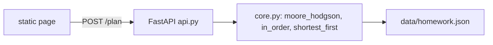

# Homework Order Planner


## Problem
With several assignments due at different times, "do the easy ones first" or "do them in the order I wrote them down" can leave you missing deadlines you could have made.

## Solution
Use the Moore-Hodgson algorithm: take tasks by due date, and whenever the running total passes a deadline, drop the longest task taken so far and do it last. This finishes the largest possible number of tasks on time. Sample (7 invented assignments): 6 on time, with only the lab report late; the listed order gets 2 and shortest-first gets 5. The result is checked against brute force over all orders in the tests.

## Architecture


## Setup
```bash
pip install -r requirements-dev.txt
PYTHONPATH=src uvicorn hwplan.api:app --port 8000
PYTHONPATH=src pytest
docker build -t hwplan . && docker run -p 8000:8000 hwplan
```
Deploy: see [DEPLOY.md](DEPLOY.md) (Render or Hugging Face Spaces).

## Design decisions
- Moore-Hodgson: it is provably optimal for maximising on-time tasks on one worker, so no heuristic doubt.
- Late tasks are done last: they cannot be saved, so they should not delay the others.
- Heap for the longest task: dropping it is O(log n) per task.
- Verified by brute force on random small cases: guards against off-by-one mistakes.

## Limitations
- One person, no breaks, no splitting a task into parts.
- Maximises the count of on-time tasks, not their importance or marks.
- Hours are estimates; tasks and deadlines are invented.

Data: invented, MIT licence.
