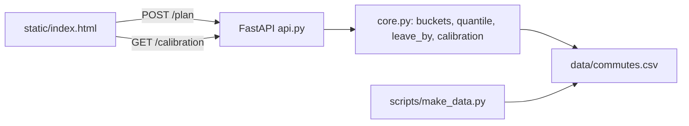

# Commute Leave-Time Planner ("Leave By")

Say when you must arrive and how often you want to be on time; get the time to leave, based on your own logged commutes.


## Problem
"It usually takes 35 minutes" is the average, so you are late about half the days. A flat buffer ignores that rush hour is slower than early morning and that you may want 95% certainty for an important meeting.

## Solution
Group logged trips by departure time (half-hour buckets, widened to neighbours until there are 15+ samples) and take the empirical quantile of trip time at the requested confidence. Search backwards from the arrival time for the latest departure whose predicted duration still arrives on time. A chronological 75/25 split checks promised against actual on-time rates on later, unseen days.

Sample result (360 training trips, 120 later test trips):

| target | actual on time |
|---|---|
| 50% | 47% |
| 70% | 64% |
| 80% | 77% |
| 90% | 88% |
| 95% | 93% |

A flat 20% buffer on the mean is on time 88% of days overall, so the quantile planner does not beat it at the 90% level. Its value is that you choose the confidence and it adapts to the departure time.

## Architecture


## Setup
```bash
pip install -r requirements-dev.txt
python scripts/make_data.py        # regenerate the synthetic log (optional)
PYTHONPATH=src uvicorn leavetime.api:app --reload   # http://localhost:8000
pytest -q && ruff check .
docker build -t leavetime . && docker run -p 8000:8000 leavetime
```
Endpoints: `GET /health`, `POST /plan`, `GET /calibration`. Deploy: [DEPLOY.md](DEPLOY.md).

## Design decisions
- Empirical quantiles, no distribution assumption: commute times have a long incident tail that a normal fit would underestimate.
- "Higher" quantile rule: rounding up never under-promises on a small sample.
- Chronological train/test split: random splits leak the future into the past for time series.
- Widen the bucket until 15 samples: sparse departure times still get an answer instead of an error.
- Report calibration in the UI and README, including the shortfall: a planner that promises 90% and delivers 88% should say so.

## Limitations
- Coverage runs 2-5 points under target (no conformal margin added); a larger log would narrow the gap.
- No live traffic, weather or day-of-week effects beyond what is in the log.
- Synthetic data: one route, two daily peaks; real commutes will differ.

## Data
`data/commutes.csv` is generated by `scripts/make_data.py` (lognormal noise, rush-hour curve, 6% incident delays); MIT with the repo.
