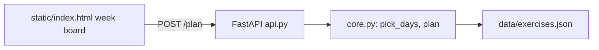

# Gym Week Planner ("Lift Week")

Pick lifts, training days and minutes; get a week where the same muscle is not hit in back-to-back sessions.


## Problem
Home lifters pile exercises into whichever day is free and end up hitting chest or back on consecutive days, or run past their time budget.

## Solution
Training days are spread evenly over the week. Exercises (most muscles and longest first) are greedily placed on the session that has time left and the fewest muscle clashes with neighbouring sessions, preferring a session that already trains the same muscle. The result reports per-day minutes, anything that did not fit, and a recovery-clash count.

## Architecture


## Setup
```bash
pip install -r requirements-dev.txt
PYTHONPATH=src uvicorn liftweek.api:app --reload   # http://localhost:8000
pytest -q && ruff check .
docker build -t liftweek . && docker run -p 8000:8000 liftweek
```
Endpoints: `GET /health`, `GET /exercises`, `POST /plan`. Deploy: [DEPLOY.md](DEPLOY.md).

## Design decisions
- Greedy placement with a clash score: a full solver is overkill for 12 exercises and greedy is easy to explain.
- Floor-based day spacing: `i*7//n` gives 0,1,3,5 for 4 days, so rest days are spread; `round()` put two sessions side by side.
- Report clashes and unplaced exercises instead of failing: the user sees the trade-off and can adjust time or days.
- Exercise data in JSON: add lifts without touching code.
- Stateless, no accounts, no personal data.

## Limitations
- Best effort, not guaranteed zero clashes; no sets, reps, load progression or injuries.
- 12 generic exercises; not coaching or medical advice.
- Muscle-group clash only; fatigue from total volume is not modelled.

## Data
`data/exercises.json`: synthetic, generic exercise list; MIT with the repo.
