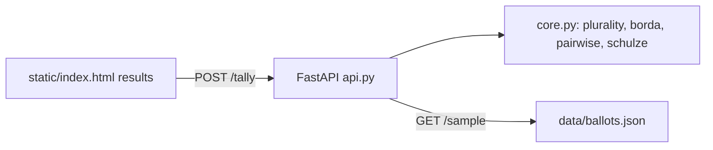

# Book Club Picker ("Club Pick")

Members rank the books; the club gets the title it actually agrees on, not just the one with the most first-place votes.


## Problem
"Everyone vote for one book" lets a polarising title win with 3 of 9 votes while most of the club ranks it last. In the sample, "The Quiet Orchard" leads plurality yet 6 of 9 members prefer "A Map of Small Rooms" to it.

## Solution
Collect full rankings and compute the pairwise preference matrix. The Schulze method turns it into a group ranking via strongest paths, so it always picks the Condorcet winner (a book that beats every other head to head) when one exists, and still resolves cycles. Plurality and Borda are shown next to it for comparison.

## Architecture


## Setup
```bash
pip install -r requirements-dev.txt
PYTHONPATH=src uvicorn clubpick.api:app --reload   # http://localhost:8000
pytest -q && ruff check .
docker build -t clubpick . && docker run -p 8000:8000 clubpick
```
Endpoints: `GET /health`, `GET /sample`, `POST /tally`. Deploy: [DEPLOY.md](DEPLOY.md).

## Design decisions
- Schulze over plurality or Borda: it is Condorcet-consistent and robust to clones, and Borda can be swung by adding bad options.
- Full rankings required: pairwise comparison needs them, and the API rejects partial ballots with a clear 422.
- Ties broken by Borda score, then title: deterministic output so the same ballots always give the same answer (tested under shuffled ballot order).
- Property test: on 100 random elections a Condorcet winner is always Schulze's first pick.
- Stateless, synthetic ballots, no accounts.

## Limitations
- No partial or approval ballots, no weights.
- No ballot privacy or one-person-one-vote enforcement; voters are labels, not accounts.
- Schulze is explainable in a paragraph but harder to hand-check than plurality.

## Data
`data/ballots.json`: invented members and book titles; MIT with the repo.
