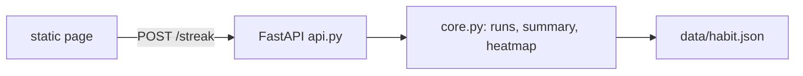

# Habit Streak Keeper


## Problem
Streak counters that reset to zero after one missed day punish people for a single slip, and discourage a good habit.

## Solution
Count a streak as a run of check-ins where consecutive check-ins are at most `grace + 1` days apart (default one missed day allowed). It reports the current streak, the longest streak, and a 9-week heatmap. Sample (invented "Read 20 minutes", 47 check-ins, today 2026-11-17): with one grace day the current streak is 20 check-ins; with no grace a single missed day on 3 Nov would reset it to 13.

## Architecture


## Setup
```bash
pip install -r requirements-dev.txt
PYTHONPATH=src uvicorn streakkeep.api:app --port 8000
PYTHONPATH=src pytest
docker build -t streakkeep . && docker run -p 8000:8000 streakkeep
```
Deploy: see [DEPLOY.md](DEPLOY.md) (Render or Hugging Face Spaces).

## Design decisions
- Grace days configurable (0-7): lets users choose how strict to be, 0 reproduces the classic rule.
- Streak length counts check-ins, not calendar days: missed grace days do not inflate the number.
- A streak stays alive until more than `grace + 1` days pass: so today not yet being logged does not break it.
- `today` is an input: results are reproducible and testable.
- Duplicate dates are collapsed: logging twice in a day counts once.

## Limitations
- Daily habits only; no "3 times a week" goals.
- No time zones: dates are plain calendar dates.
- Check-ins are invented, nothing personal is stored.

Data: invented, MIT licence.
