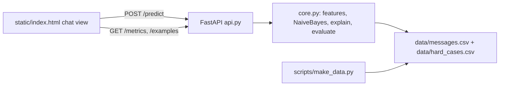

# SMS Spam Shield

A Naive Bayes spam filter written from scratch, with per-message explanations and an adjustable threshold, evaluated honestly on both easy and tricky messages.


## Problem
Spam texts imitate parcels, banks and prizes, while ordinary messages also say "free", "now" and "claim". A filter has to weigh evidence, show why it decided, and let the owner choose how many real messages they are willing to lose.

## Solution
Multinomial Naive Bayes over lower-cased words and bigrams plus three shape features (URL, digits, shouting). The decision is the log-odds of spam vs ham compared with a threshold. Each prediction returns the features that pushed hardest each way. The model is about 100 lines of plain Python: no ML library.

## Results (read these before the headline)
- Templated test set (180 held-out synthetic messages): 100% accuracy. This only shows the code works; the templates repeat, so it is easy.
- 25 hand-written tricky messages (ham using spam words, spam in a friendly tone):

| threshold | accuracy | precision | recall |
|---|---|---|---|
| -4 | 76% | 64% | 90% |
| -2 | 76% | 75% | 60% |
| 0 | 72% | 100% | 30% |
| 2 | 64% | 100% | 10% |

Always answering "ham" would score 60% on that set. At the default threshold the filter is precise but misses most friendly-sounding phishing; lowering the threshold catches more at the cost of flagging some real messages. These 25 are a diagnostic, not a benchmark, and I did not tune on them.

## Architecture


## Setup
```bash
pip install -r requirements-dev.txt
python scripts/make_data.py        # regenerate the synthetic messages (optional)
PYTHONPATH=src uvicorn spamshield.api:app --reload   # http://localhost:8000
pytest -q && ruff check .
docker build -t spamshield . && docker run -p 8000:8000 spamshield
```
Endpoints: `GET /health`, `GET /examples`, `GET /metrics`, `POST /predict`. Deploy: [DEPLOY.md](DEPLOY.md).

## Design decisions
- From-scratch Naive Bayes: tiny, fast, and its evidence is directly readable, which is what the explanations need.
- Log-odds with a user-set threshold: spam vs ham errors cost different amounts to different people.
- Separate hand-written hard set: templated data scores 100% and would hide the weakness.
- Laplace smoothing and ignoring unseen words: a new word must not zero out a message.
- Stateless API, retrain at startup (milliseconds): no model files to ship.

## Limitations
- Training text is synthetic and template-based; real spam evolves and is far more varied.
- Bag-of-words ignores sender, timing and message volume.
- The hard set has only 25 messages: treat percentages as rough.

## Data
`data/messages.csv` is generated by `scripts/make_data.py` from invented templates; `data/hard_cases.csv` is hand-written. Both are original and MIT with the repo; no real messages or numbers.
