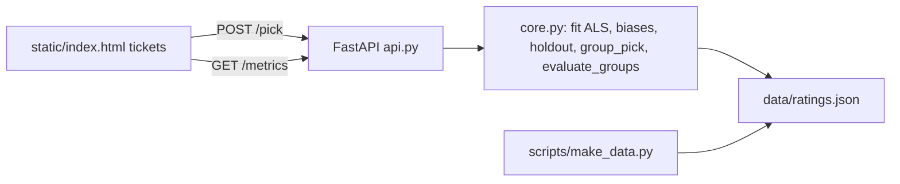

# Movie Night Recommender

Choose who is on the sofa; get films none of you has seen, ranked so that the least-happy person still likes it.


## Problem
Group film choice usually ends with the loudest person's favourite. The group needs something every member will tolerate, picked from films nobody has already seen.

## Solution
Predict every viewer's rating of every film with a biased matrix-factorisation model (rank 3, alternating least squares on observed ratings only), then rank unseen films by the group's *least misery* (lowest predicted member rating) or by average. Evaluated on synthetic ratings generated from hidden genre tastes, so the true score of any pick is known:

- Held-out rating error (RMSE, 142 test ratings): model 0.85, per-film average 0.92, one global average 1.01.
- Mean true rating of the worst-off member for picks on random groups of 4: least-misery 3.09, average 3.08, most-popular 3.06, random film 2.36. The three strategies are close; all beat random by about 0.7 stars.

## Architecture


## Setup
```bash
pip install -r requirements-dev.txt
python scripts/make_data.py        # regenerate the synthetic ratings (optional)
PYTHONPATH=src uvicorn moviepick.api:app --reload   # http://localhost:8000
pytest -q && ruff check .
docker build -t moviepick . && docker run -p 8000:8000 moviepick
```
Endpoints: `GET /health`, `GET /sample`, `GET /metrics`, `POST /pick`. Deploy: [DEPLOY.md](DEPLOY.md).

## Design decisions
- Biased matrix factorisation, not plain factors: without user and film offsets the model was worse (RMSE 0.94) than a per-film average (0.92); with them it is clearly better.
- Heavy regularisation and low rank (3): only about 17 ratings per user, so a larger model overfits.
- Least misery as the default strategy: it targets the failure that ruins group nights, the one person who hates the film.
- Synthetic data with known true ratings: the only way to measure a pick's real quality rather than just fit to noisy labels.
- Retrain at startup (under a second): no model files or versioning to manage.

## Limitations
- Strategy differences are small on this data (a few hundredths of a star); I would not claim one is better without larger real data.
- Cold start: a viewer with no ratings gets only film popularity.
- Ratings are synthetic; real tastes are less low-rank.

## Data
`data/ratings.json` is generated by `scripts/make_data.py` (invented viewers and films, hidden genre tastes plus noise); MIT with the repo.
