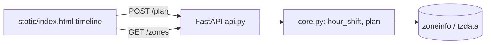

# Jet Lag Planner ("Jet Lag Plan")

Choose a route, a flight day and your usual sleep times; get a day-by-day plan that moves your body clock toward the destination, with the same moments shown on the home and destination clocks.


## Problem
Crossing many time zones leaves people awake at the wrong hours for days. Advice such as "adjust gradually" rarely says by how much, in which direction, or what that means in local time.

## Solution
Compute the true clock difference between two IANA time zones on the flight date (daylight saving and half-hour zones included), taking the shorter way around the clock (a +14 h gap is really -10 h). Then plan a gradual shift at a fixed heuristic rate: about 1 h/day earlier going east, 1.5 h/day later going west (delaying is easier than advancing). The plan starts up to 7 days before the flight and continues after landing until the shift is complete, and gives bedtime and wake time on both clocks plus a simple light-exposure window.

Example: Kolkata to New York in November is a 10.5 h westward shift, so 7 days at 1.5 h/day; the last row's 09:30 home-clock bedtime is 23:00 local.

## Architecture


## Setup
```bash
pip install -r requirements-dev.txt
PYTHONPATH=src uvicorn jetlag.api:app --reload   # http://localhost:8000
pytest -q && ruff check .
docker build -t jetlag . && docker run -p 8000:8000 jetlag
```
Endpoints: `GET /health`, `GET /zones`, `POST /plan`. Deploy: [DEPLOY.md](DEPLOY.md).

## Design decisions
- Real time-zone data (`zoneinfo` with `tzdata`) instead of a fixed offset table: daylight saving makes the same route a different shift in March than in November (tested: London to New York is -4 h on 20 March but -5 h on 20 November).
- Shorter direction around the clock: Tokyo to Los Angeles is +7 h eastward, not -17 h.
- Different east and west rates: the commonly quoted rule of thumb is that advancing is slower than delaying.
- Home-clock and destination-clock columns side by side: people otherwise mix up which clock a time refers to.
- Stateless API, no accounts or personal data: only zones and sleep hours are sent.

## Limitations
- A rule-of-thumb planner, not medical advice and not personalised (no age, chronotype or medication).
- Long pre-flight shifts can push home bedtimes into the small hours (e.g. 05:00 by flight day in the sample); reduce "days before" if that is impractical.
- Light advice is a simple window, not circadian-phase modelling; trips under about 3 h need no plan.

## Data
No dataset: time-zone rules come from the IANA tz database via Python's `zoneinfo`/`tzdata`.
