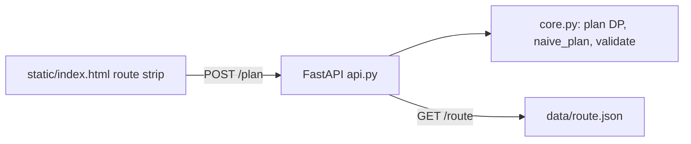

# Road Trip Stop Planner ("Pit Stops")

Choose the fewest fuel and break stops for a drive, at the cheapest fuel, given tank range and the longest stretch you will drive without stopping.


## Problem
On a long drive you need fuel before the tank runs out and a break before you tire. Stopping at every station wastes time; stopping too late strands you.

## Solution
A dynamic programme over states (last stop, last fuel stop) chooses the stops that satisfy both limits with the fewest stops, and among those the lowest total fuel price. Sample 540 km route: 4 stops at an average $1.68/l, against 5 stops at $1.77/l for a "furthest reachable stop" greedy plan.

## Architecture


## Setup
```bash
pip install -r requirements-dev.txt
PYTHONPATH=src uvicorn tripstops.api:app --reload   # http://localhost:8000
pytest -q && ruff check .
docker build -t tripstops . && docker run -p 8000:8000 tripstops
```
Endpoints: `GET /health`, `GET /route`, `POST /plan`. Deploy: [DEPLOY.md](DEPLOY.md).

## Design decisions
- DP over (last stop, last fuel stop): greedy "go as far as possible" is not optimal when kinds of stops interleave; two-index state is small (n^2) and exact.
- Lexicographic objective (stops, then fuel price): stops cost the traveller time, price only breaks ties between equally short plans.
- A brute-force subset checker in the tests on 60 random routes: proves optimality, not just validity.
- Impossible trips return a clear 422 instead of a bad plan: the user can raise range or leg length.
- Route in JSON, stateless API: swap in another route without code changes.

## Limitations
- Fixed fuel price per station, no litres or tank level model (range limit only).
- One straight route; no detours, tolls or opening hours.
- Stop time is not counted in the objective.

## Data
`data/route.json`: synthetic route, stop names and prices; MIT with the repo.
