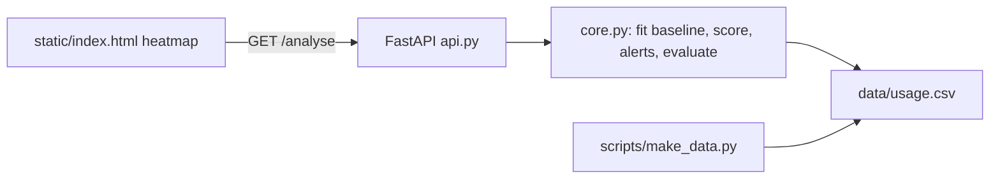

# Home Energy Anomaly Watch ("Power Watch")

Learn what a household's normal electricity use looks like for each hour of the day, then flag faults such as a fridge door left open, a stuck heater or an outage.


## Problem
Meters show totals, not "this hour is wrong". Faults like an oven left on or a heater stuck on are invisible in a monthly bill until it is too late, and a single flat threshold either misses them or alarms constantly because evening use is normally high.

## Solution
Baseline: for each (weekday-or-weekend, hour) slot, the median of the training days and a robust spread (MAD scaled to a standard deviation). Score each reading as `(kWh - median) / spread`. Raise an alert only for `min_run` consecutive hours (default 2) beyond the threshold (default 4) with the same sign, so one noisy hour does not alarm.

On 28 synthetic days (14 to learn, 14 to watch, 4 injected faults: fridge open +0.45 kWh/h for 8 h, heater +1.6 for 6 h, oven +0.9 for 5 h, outage -0.9 for 4 h):

| method | faults caught | false alarms |
|---|---|---|
| seasonal baseline, threshold 4, 2 hours in a row (default) | 4 of 4 | 0 |
| same, but a single hour is enough (threshold 3) | 4 of 4 | 6 |
| flat 3-sigma rule on all readings | 1 of 4 | 3 |

Single-hour scores overlap (the worst normal hour scores 4.5, the mildest fault hour 4.1), so it is the run requirement that removes false alarms.

## Architecture


## Setup
```bash
pip install -r requirements-dev.txt
python scripts/make_data.py        # regenerate the synthetic usage (optional)
PYTHONPATH=src uvicorn energywatch.api:app --reload   # http://localhost:8000
pytest -q && ruff check .
docker build -t energywatch . && docker run -p 8000:8000 energywatch
```
Endpoints: `GET /health`, `GET /analyse?threshold=4&min_run=2`. Deploy: [DEPLOY.md](DEPLOY.md).

## Design decisions
- Median and MAD instead of mean and standard deviation: a past fault in the training data would not poison the baseline.
- Per-slot (weekday type x hour) baseline: evening peaks and weekend routines are normal, not anomalies.
- Run-length rule: faults last hours; random noise rarely stays extreme for two hours.
- Event-level evaluation (was each fault caught, how many alerts overlapped nothing): a fault is one event, not eight rows.
- Synthetic data with labelled faults: the only way to measure recall without real meter data.

## Limitations
- The injected faults are large (about 5-25 spreads); small faults, such as a slowly degrading fridge, would not be caught.
- Two weeks of training and two daily patterns; holidays, new appliances or seasons need retraining.
- A single synthetic household; real usage is noisier and shifts with weather.

## Data
`data/usage.csv` is generated by `scripts/make_data.py` (daily curve plus Gaussian noise plus four labelled faults); MIT with the repo.
