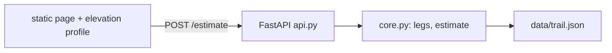

# Hike Time Estimator


## Problem
Planning a hike by distance alone makes steep routes take far longer than expected, and people end up descending in the dark.

## Solution
Apply Naismith's rule to each leg of the route: walking time at 5 km/h plus 10 minutes for every 100 m climbed (descent gets no credit), add rest time, then work back from sunset to the latest start time, with a 30-minute margin. Sample (invented 12.4 km trail with 760 m of climbing): 4 h 04 min in total, 95 minutes more than the 2 h 29 min a distance-only guess gives, so the latest start is 12:06 for a 16:40 sunset.

## Architecture


## Setup
```bash
pip install -r requirements-dev.txt
PYTHONPATH=src uvicorn hiketime.api:app --port 8000
PYTHONPATH=src pytest
docker build -t hiketime . && docker run -p 8000:8000 hiketime
```
Deploy: see [DEPLOY.md](DEPLOY.md) (Render or Hugging Face Spaces).

## Design decisions
- Naismith's rule: a long-established, simple rule of thumb that walkers already know and can check.
- Time per leg, not per route: so the table shows which legs are costly.
- Descent has no credit and no penalty: the original rule has no descent term; steep descents are a known limitation.
- 30-minute margin before sunset: a safety buffer that is easy to change.
- Pace and ascent time are inputs: fitter or slower walkers can set their own.

## Limitations
- Ignores terrain, weather, group size and steep descents, which can be slow.
- Estimates, not safety advice: always carry a map and a torch.
- The trail is invented, not a real route.

Data: invented, MIT licence.
