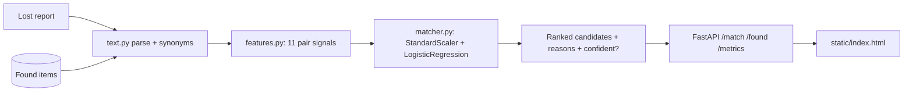

# Lost and Found Matcher


A phone left on a bus and a phone handed in at the library are the same phone, but nobody connects them: one person writes "mobile, navy cover", the other writes "dark blue cellphone". This project matches lost-item reports to found items the way a patient desk clerk would, and tells you why.


## Questions it answers
**Is any of the found items mine?** Describe your item, place and date. You get the five closest items as tags, each with a match score and reasons ("same colour (white)", "same brand (Orbyt)", "found at the same spot"). If nothing is convincing it says so instead of guessing.

**What if it is handed in tomorrow?** Switch to "I found something", hand it in, and the next search includes it (kept in memory only in the demo).

**Can I trust the score?** On held-out reports: the right item is first for **95%** of owners and in the top three for **100%**; plain text matching alone gets 79%. Of reports whose item was never handed in, **89%** are correctly answered with "no confident match". See the table below.

## How it works
1. **Read the description.** Synonyms collapse to one word (`rucksack`, `school bag` → backpack; `navy`, `dark blue` → blue); brand and details like "cracked" or "name tag" are extracted.
2. **Compare each pair** on 11 signals: TF-IDF text similarity, same or conflicting category, colour, brand, shared details, handed in before it was lost, days between, and distance across a campus map.
3. **Score with logistic regression** trained on labelled pairs, using the most confusable wrong items as negatives.
4. **Decide if it is confident** with a threshold tuned for the best F1 on training reports.



## Results
| Check (84 held-out reports, 57 with a real match) | Result |
|---|---|
| Right item ranked first (recall@1) | 0.947 |
| Right item in top 3 (recall@3) | 1.000 |
| Text-only baseline, recall@1 | 0.789 |
| Reports with no match correctly rejected | 0.889 |
| Precision when it says "confident" | 0.906 |

What the model learned (standardised weights): handed in before it was lost and long gaps are the strongest negatives, text similarity the strongest positive, a conflicting category or colour cancels the matching one.

## Run it
```bash
python -m venv .venv && source .venv/bin/activate && pip install -r requirements-dev.txt
python scripts/generate_data.py                 # data/ is committed; this rebuilds it
PYTHONPATH=src python -m lostfound.train
PYTHONPATH=src uvicorn lostfound.api:app        # http://localhost:8000, docs at /docs
pytest -q && ruff check .
```
Docker: `docker build -t lost-and-found . && docker run --rm -p 8000:8000 lost-and-found`. Hosting: [DEPLOY.md](DEPLOY.md).

## Design decisions
- **Learned weights over hand-tuned rules** — logistic regression turns eleven signals into one probability, shows its weights, and is retrainable on a real desk's confirmed matches.
- **Hard negatives in training** — the 12 most text-similar wrong items per report teach the model to separate near-twins (two red wallets), which random negatives do not.
- **Conflict features, not just match features** — "both have a colour and they differ" is stronger evidence than "colour unknown"; missing information is treated as neutral.
- **Reasons come from the same attributes as the score** — the explanation cannot disagree with the ranking.
- **A tuned "confident" threshold and an honest "no match"** — a wrong confident answer sends someone home with a false hope, which is worse than asking them to check back.
- **Campus map as coordinates** — gives a smooth place-distance signal without a routing engine.
- **Demo pool in memory, 2,000 item cap** — nothing personal is stored; a real deployment would add a database.
- **Visual system dealt with taste-skill**: palette "limewash-ochre", type Outfit, luggage-tag results with a punched hole; the best match gets an outline.
- **No names, phone numbers or photos anywhere** — descriptions only, all invented.

## Dataset
`data/found.csv` (320 items) and `data/lost.csv` (240 reports, 160 with a true `match_id`) are generated by `scripts/generate_data.py` (seed 21) for a fictional campus. Descriptions use different words for the same colour or item, optional brands, and details, so matching is not trivial. CC0.

## Limitations
- Real descriptions have typos, other languages and vague wording ("my black thing"); parsing is dictionary-based and would need a typo-tolerant step.
- Synthetic descriptions follow templates, so the scores are optimistic compared with real desks.
- No photos; image similarity would be the natural next signal.
- The pool resets on restart, and nobody is notified when a match appears later.

## License
MIT.
