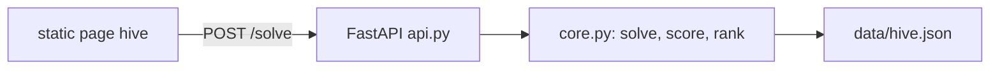

# Word Hive Solver


## Problem
In letter-hive puzzles you get seven letters, one of them in the centre, and must find every word of four or more letters that uses only those letters and always includes the centre letter. Finding them all by hand takes a long time.

## Solution
Filter a word list with three rules (length, centre letter, allowed letters), score each word (4 letters = 1 point, longer = one point per letter, a pangram that uses all seven letters gets +7), and sort best first. Sample (letters D E A L I N G, centre E): 51 words worth 195 points, with three pangrams (aligned, dealing, leading).

## Architecture


## Setup
```bash
pip install -r requirements-dev.txt
PYTHONPATH=src uvicorn wordhive.api:app --port 8000
PYTHONPATH=src pytest
docker build -t wordhive . && docker run -p 8000:8000 wordhive
```
Deploy: see [DEPLOY.md](DEPLOY.md) (Render or Hugging Face Spaces).

## Design decisions
- Set-based filtering (`set(word) <= letters`): one line expresses the rule and repeats of a letter are allowed.
- Words come from a request or the bundled list: the same solver works on any dictionary the caller supplies.
- Hand-written mini word list of about 170 words: avoids licence questions; it is not a full dictionary.
- Ranks are share-of-points thresholds: a simple, explainable rule.

## Limitations
- The bundled list is tiny, so a real puzzle would find many more words.
- No plurals or proper-noun filtering beyond what the supplied list contains.
- English only.

Data: hand-written word list, MIT licence.
