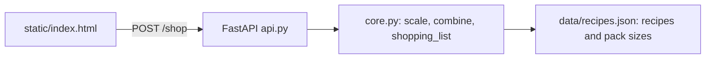

# Recipe Scaler & Shopping List ("Cook for N")

Pick dishes and a headcount; get a shopping list rounded to real pack sizes.


## Problem
Recipes serve 4, dinner is for 7, and shops sell whole packs. Scaling by hand gives "283 g of rice", and shopping per dish buys the same half-used packs twice.

## Solution
Scale every dish linearly to the headcount, merge shared ingredients across dishes, subtract what is already in the cupboard, then round up to whole packs. Sample: curry plus tomato egg rice for 4 costs $22.70 shopped together vs $28.50 shopped per dish.

## Architecture


## Setup
```bash
pip install -r requirements-dev.txt
PYTHONPATH=src uvicorn cookscale.api:app --reload   # http://localhost:8000
pytest -q && ruff check .
docker build -t cookscale . && docker run -p 8000:8000 cookscale
```
Endpoints: `GET /health`, `GET /recipes`, `POST /shop`. Deploy: [DEPLOY.md](DEPLOY.md).

## Design decisions
- Merge ingredients before rounding to packs: rounding per dish overbuys; ceil is subadditive, so combined never costs more (tested).
- Linear scaling only: spices and salt do not scale perfectly, but a simple documented rule beats a guess.
- Pack sizes and prices in JSON: shops differ, so users can swap in their own without code changes.
- Tolerance in the pack rounding (1e-9): floating point should not make 1000 g need two 1000 g packs.
- Stateless API: cupboard stock is sent per request, nothing stored.

## Limitations
- Three sample recipes, one price per item, single currency.
- No unit conversion (g vs cups) or ingredient substitutions.
- Cooking time and equipment do not scale.

## Data
`data/recipes.json`: synthetic recipes and prices; MIT with the repo.
