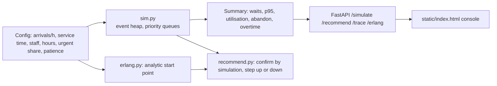

# Waiting Room Simulator


> **"What happens to our waiting times if we lose a nurse on Tuesdays?"** A walk-in clinic can guess, or it can replay a thousand Tuesdays in a second.


## Can the simulator be trusted?
Before anything else: the simulator is checked against a formula that is known to be right.

| Check | Simulation | Erlang C formula |
|---|---|---|
| 5 staff, 20 patients/h, 12 min each: mean wait | 6.5 min (±2.0, 95% CI) | 6.65 min |
| Utilisation vs offered load (20 × 12 / 60 / 5) | 0.80 | 0.80 |
| M/M/1 hand check (tests): mean wait | 9.0 min | 9.0 min |

These run in the test suite (31 tests), along with determinism per seed, more staff means shorter waits, urgent patients waiting less than routine ones, walk-outs lowering the queue, and an overloaded clinic growing overtime.

## What it answers
- **How long will patients wait?** Average, 90th and 95th percentile, by arrival hour, with a confidence interval.
- **Is my promise kept?** "90% of patients wait 30 minutes or less" is checked against the simulated day.
- **How many staff do I need?** The recommender starts from the Erlang C answer for the busiest hour, then confirms with simulation under real conditions (a lunchtime dip, urgent patients, people who leave) and moves up or down until it finds the smallest team that keeps the promise.
- **What does it feel like?** The floor view replays one simulated day: the waiting area on the left, each staff lane on the right.

## How it works

1. **Arrivals** come from a time-varying Poisson process generated by thinning, so a mid-morning surge is realistic.
2. **Queues**: urgent patients are served first, FIFO within each class. Patients may give up after a random patience time.
3. **Service times** are exponential, or lognormal if you set a variability other than 1.
4. **Replications**: 25-30 independent days with different seeds give means, percentiles and a confidence interval.
5. **Recommendation** walks the staffing level until the promise flips from missed to kept.

## Run it
```bash
python -m venv .venv && source .venv/bin/activate && pip install -r requirements-dev.txt
PYTHONPATH=src uvicorn waitsim.api:app          # http://localhost:8000, docs at /docs
pytest -q && ruff check .
```
Docker: `docker build -t waiting-room . && docker run --rm -p 8000:8000 waiting-room`. Hosting: [DEPLOY.md](DEPLOY.md). No model training and no data files: it is a pure simulation, so the image is tiny.

## Design decisions
- **Discrete-event simulation with a heap, not a time-step loop** — exact event times, fast in pure Python, and no step size to tune.
- **Validate against Erlang C in the tests** — a simulator nobody can check is a toy; matching a closed form (and an M/M/1 hand calculation) is the evidence it is right.
- **Recommendation = analytic start + simulation check** — the formula is instant and a good first guess, simulation covers what the formula cannot (daily profile, priorities, walk-outs).
- **Independent replications with a CI** — one simulated day is an anecdote; 30 are an estimate with an error bar.
- **Seeded randomness, one generator per replication** — identical inputs give identical outputs (tested), and replications are independent.
- **`/trace` returns one replication patient by patient** — the UI replays real simulated events instead of an invented animation.
- **Priority classes with FIFO inside each** — the simplest triage rule that matches how urgent cases really jump the queue.
- **Visual system dealt with taste-skill**: palette "graphite-safety-orange" (dark first, with a light set), Geist + Geist Mono, a three-column operations console.
- **No patient data** — all arrivals are generated; nothing personal anywhere.

## Limitations
- The promise is judged on patients who were seen; people who walked out are reported separately (a clinic with many walk-outs can look good on waits while losing patients).
- One queue and identical staff; no separate rooms, skill mixes or breaks.
- Exponential and lognormal service times only; real consultation times have their own shape.
- Arrival rates are assumptions you set, not forecasts learned from a clinic's records.

## License
MIT.
