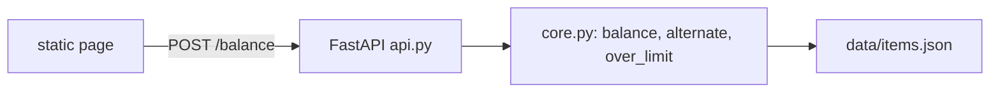

# Bag Weight Balancer


## Problem
Two people travelling with two bags want the weights to match, and neither bag over the airline limit. Packing "one for you, one for me" in list order rarely achieves that.

## Solution
Treat it as a partition problem: a subset-sum table over the item weights (in 10 g units) finds the split with the smallest weight difference. Sample (12 invented items, 11 kg limit per bag): the balanced split is 10.6 kg and 10.7 kg (100 g apart, the best possible with these weights), while alternating items gives 14.1 kg and 7.2 kg, with one bag over the limit. The tests check the result against brute force.

## Architecture


## Setup
```bash
pip install -r requirements-dev.txt
PYTHONPATH=src uvicorn bagbalance.api:app --port 8000
PYTHONPATH=src pytest
docker build -t bagbalance . && docker run -p 8000:8000 bagbalance
```
Deploy: see [DEPLOY.md](DEPLOY.md) (Render or Hugging Face Spaces).

## Design decisions
- Subset-sum dynamic programming: exact, and fast for a packing list of dozens of items.
- Weights rounded to 10 g inside the table: keeps the table small; the exact weights are reported afterwards.
- Lighter bag is always A: stable, easy-to-read output.
- Limit check is separate from balancing: balanced bags can still both be over, and the page says so.

## Limitations
- Only two bags and weight only: no volume, fragile items or "keep these together" rules.
- Rounding to 10 g can in rare cases miss the exact optimum by a few grams.
- Items and weights are invented.

Data: invented, MIT licence.
