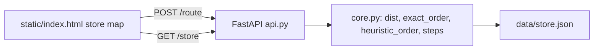

# Grocery Aisle Route ("Aisle Walk")

Tick a shopping list; get the shortest path through a supermarket, drawn on the store map.


## Problem
People shop in the order they wrote the list and zig-zag between aisles and the back wall. In a shop where you can only walk along aisles and two corridors, a good visiting order can cut the walk sharply.

## Solution
Model the shop as parallel aisles joined by a front and a back corridor, with the entrance at the front of the first aisle and the checkout at the front of the last. Walking distance between shelf positions follows the aisles. The best order is found exactly with Held-Karp dynamic programming (up to 14 items) and with nearest-neighbour plus 2-opt above that.

Sample list of 10 items (milk, apples, pasta, water, bread, tuna, crisps, dish soap, eggs, rice), distances in steps:

| order | steps |
|---|---|
| as ticked (the order you thought of them) | 159 |
| simply sorted by aisle, front to back | 75 |
| optimal (Held-Karp) | 67 |

So the planner saves 58% against ticking order but only 11% against a sensible "go aisle by aisle" walk: most of the win is avoiding backtracking, the optimiser adds the last few steps (such as using the back corridor).

## Architecture


## Setup
```bash
pip install -r requirements-dev.txt
PYTHONPATH=src uvicorn aislewalk.api:app --reload   # http://localhost:8000
pytest -q && ruff check .
docker build -t aislewalk . && docker run -p 8000:8000 aislewalk
```
Endpoints: `GET /health`, `GET /store`, `POST /route`. Deploy: [DEPLOY.md](DEPLOY.md).

## Design decisions
- Held-Karp for small lists: exact, and 14 items is 14^2 x 2^14 (about 3M) operations, instant in Python; verified against brute force on random 6-item lists.
- Nearest-neighbour + 2-opt above 14 items: stays responsive on long lists; tests check it is valid and within 15% of exact on 10 items.
- Distance through corridors, not straight lines: you cannot walk through shelves, so Manhattan distance would lie.
- Honest baselines in the README and UI: the UI baseline is the order you ticked, and the README also shows the aisle-sorted walk.
- Stateless API, invented store: no real shop data.

## Limitations
- One generic layout; real shops have islands, one-way systems and queues.
- Items have a single shelf position; no stock-outs or substitutions.
- Distance is in steps, not seconds (no crowds or trolley turning).

## Data
`data/store.json`: invented layout and product positions; MIT with the repo.
