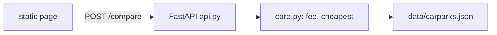

# Car Park Fee Comparator


## Problem
Three car parks near the same shops have different tariffs (cheap first hour, dear hours after, daily caps). Which is cheapest depends on how long you stay.

## Solution
Compute each fee exactly (first hour, then hourly with part hours rounded up, capped per 24 hours) and mark the cheapest per stay length. Sample (invented tariffs):

| Stay | Station | Mall | Council | Cheapest |
|---|---|---|---|---|
| 30 min | $4.00 | $1.00 | $2.50 | Mall |
| 90 min | $5.50 | $3.50 | $4.50 | Mall |
| 3 h | $7.00 | $6.00 | $6.50 | Mall |
| 6 h | $11.50 | $13.50 | $9.00 | Council |
| 10 h | $12.00 | $15.00 | $9.00 | Council |

## Architecture


## Setup
```bash
pip install -r requirements-dev.txt
PYTHONPATH=src uvicorn parkfee.api:app --port 8000
PYTHONPATH=src pytest
docker build -t parkfee . && docker run -p 8000:8000 parkfee
```
Deploy: see [DEPLOY.md](DEPLOY.md) (Render or Hugging Face Spaces).

## Design decisions
- Part hours round up: that is how most tariffs bill.
- Cap applied per 24-hour block: matches a daily cap on a multi-day stay.
- Ties go to the alphabetically first name: deterministic output.
- Stateless API, invented tariffs: nothing personal stored.

## Limitations
- No evening or weekend flat fees, validation windows or free periods.
- Stays up to 7 days.
- Tariffs are invented, not any real operator's.

Data: invented, MIT licence.
