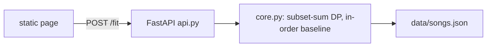

# Playlist Fitter


## Problem
You know how long the drive is and have a long list of songs. Playing top to bottom ends with a cut-off song or dead air.

## Solution
A subset-sum dynamic programme finds the songs (kept in list order) whose total length is as close as possible to the trip length without going over; ties go to fewer songs. Sample (24 invented songs, 60-minute trip):

| Plan | Songs | Total | Gap to 60:00 |
|---|---|---|---|
| Best fit (DP) | 13 | 60:00 | 0:00 |
| Top to bottom until it would overrun | 14 | 59:16 | 0:44 |

The gain on this sample is modest (44 seconds); it grows when a few long songs sit early in the list.

## Architecture


## Setup
```bash
pip install -r requirements-dev.txt
PYTHONPATH=src uvicorn playfit.api:app --port 8000
PYTHONPATH=src pytest
docker build -t playfit . && docker run -p 8000:8000 playfit
```
Deploy: see [DEPLOY.md](DEPLOY.md) (Render or Hugging Face Spaces).

## Design decisions
- Exact DP over whole seconds: optimal, and 3,600 s x 200 songs is tiny (checked against brute force).
- Never exceed the target: a cut-off last song is the failure being avoided.
- Fewer songs on ties: fewer transitions and a simpler list.
- Stateless API, invented data: nothing personal stored.

## Limitations
- Ignores song quality and mood: it only fits lengths.
- Songs keep list order; no reordering for flow.
- Limits: 200 songs, 600 minutes.

Data: invented, MIT licence.
