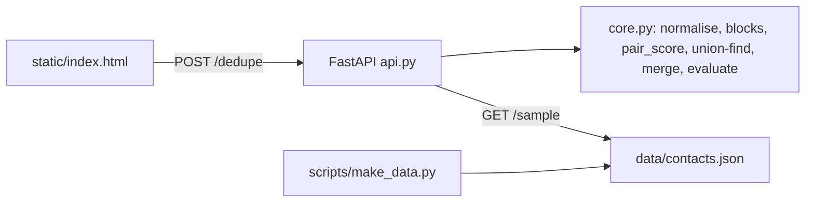

# Contact Dedupe ("Tidy Contacts")

Find and merge duplicate address-book entries (typos, nicknames, "SMITH, Jim", new phone numbers) and measure how well it did against known answers.


## Problem
Phone and email imports leave several records per person. Exact matching misses "Kenij Khan" and "(902) 048 6495"; naive fuzzy matching merges different people who share a surname.

## Solution
Normalise names (case, "Last, First", nicknames, initials) and phones (last 10 digits). Block on cheap keys (surname prefix, first-name prefix, phone, email) so only plausible pairs are compared. Score each pair: a shared phone or email is strong evidence, boosted by name similarity; otherwise only name similarity counts, discounted. Pairs above a threshold are clustered with union-find and merged. On the synthetic book (141 contacts, 39 true duplicate pairs, 12 deliberate look-alikes) the default threshold 0.80 gives precision 0.94 and recall 0.85.

| threshold | precision | recall |
|---|---|---|
| 0.70 | 0.68 | 1.00 |
| 0.80 | 0.94 | 0.85 |
| 0.85 | 1.00 | 0.79 |

## Architecture


## Setup
```bash
pip install -r requirements-dev.txt
python scripts/make_data.py        # regenerate the synthetic book (optional)
PYTHONPATH=src uvicorn dedupe.api:app --reload   # http://localhost:8000
pytest -q && ruff check .
docker build -t dedupe . && docker run -p 8000:8000 dedupe
```
Endpoints: `GET /health`, `GET /sample`, `POST /dedupe` (returns clusters, merged records, and precision/recall when `group` labels are supplied). Deploy: [DEPLOY.md](DEPLOY.md).

## Design decisions
- Blocking instead of all-pairs: n^2 comparisons do not scale; shared keys keep it near-linear for real books.
- Rules plus difflib, not a trained model: no labelled real data to train on and every decision stays explainable.
- Union-find clustering: duplicates are transitive (A=B, B=C), and it is O(n) after the scoring.
- Name-only matches are discounted (x0.8): a shared surname and similar first name is exactly how look-alikes slip in.
- Ground-truth labels in the synthetic data: lets the project report precision and recall instead of "looks right".

## Limitations
- Transitive merging can chain: a very low threshold (0.6) merges almost everything.
- Names only in Latin script; nickname table is tiny and English-centric.
- Synthetic duplicates are easier than real address books; treat the numbers as a regression baseline, not a benchmark.

## Data
`data/contacts.json` is generated by `scripts/make_data.py` from invented names; MIT with the repo.
