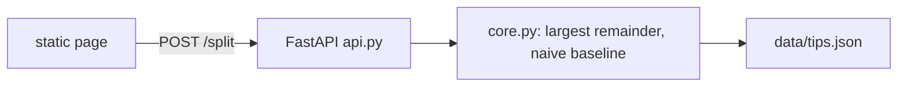

# Tip Pool Splitter


## Problem
A cafe splits a tip pool by hours worked. Rounding each share to the cent can make the payouts add up to a cent more or less than the pool, and someone has to cover or pocket the difference.

## Solution
The largest-remainder method: everyone gets their rounded-down share, then the leftover cents go to the biggest fractional remainders (ties go to the earlier name). The total is always exactly the pool. Sample ($100.00, three staff on 10 hours each):

| Method | Payouts | Total |
|---|---|---|
| Largest remainder | $33.34, $33.33, $33.33 | $100.00 |
| Naive rounding | $33.33 each | $99.99 |

## Architecture


## Setup
```bash
pip install -r requirements-dev.txt
PYTHONPATH=src uvicorn tippool.api:app --port 8000
PYTHONPATH=src pytest
docker build -t tippool . && docker run -p 8000:8000 tippool
```
Deploy: see [DEPLOY.md](DEPLOY.md) (Render or Hugging Face Spaces).

## Design decisions
- Integer cents throughout: no floating-point money in the payouts.
- Largest remainder: exact total and every share within one cent of the ideal (property-tested on 300 random pools).
- Ties to the earlier name: deterministic, so re-running gives the same answer.
- Stateless API, invented staff: nothing personal stored.

## Limitations
- Splits by hours only; no weighting by role.
- The extra cent always goes to someone, which cannot be made perfectly fair.
- Sample uses equal hours to make the rounding gap obvious.

Data: invented, MIT licence.
