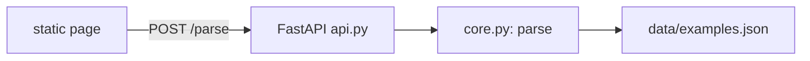

# Quick Event Parser


## Problem
People write plans as sentences ("Dentist next Monday 9:30am for 45 minutes") but calendars want a date, a time and a title.

## Solution
A small rule-based parser pulls out a duration, a clock time and a date, and treats the rest as the title. It understands `today`, `tomorrow`, `day after tomorrow`, `in N days/weeks`, weekdays (`Friday`, `next Monday`), `Dec 5` / `5 Dec`, ISO dates, `1pm`, `9:30am`, `17:00`, `noon`, `midnight` and `for 2 hours / 45 minutes`. Sample (7 invented sentences, today Tue 2026-11-17): 6 are complete; "Pick up parcel day after tomorrow" has a date (19 Nov) but no time, and the page flags that.

## Architecture


## Setup
```bash
pip install -r requirements-dev.txt
PYTHONPATH=src uvicorn eventparse.api:app --port 8000
PYTHONPATH=src pytest
docker build -t eventparse . && docker run -p 8000:8000 eventparse
```
Deploy: see [DEPLOY.md](DEPLOY.md) (Render or Hugging Face Spaces).

## Design decisions
- Regular expressions, no ML: these phrases are a small closed grammar, rules are predictable and testable.
- `today` is an input: results are reproducible (a parser that reads the clock cannot be unit-tested well).
- "next Friday" means Friday of the following week; a bare weekday means the coming one (never today): a stated, tested convention.
- Missing time or date is reported, not guessed: the page shows "no time" instead of inventing 9am.
- Invalid dates ("Feb 30") raise an error: better than a silently wrong event.

## Limitations
- English only; no "the 3rd", "end of month", ranges or time zones.
- One event per sentence.
- A month name inside a title (e.g. "May") can be read as a date.

Data: invented, MIT licence.
