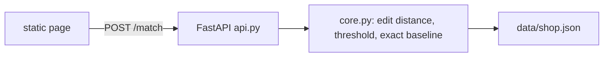

# Shopping Typo Matcher


## Problem
Typed shopping lists are full of typos ("aples", "chiken brest") that exact-match lookups against a store catalogue miss.

## Solution
Edit distance (with adjacent transpositions, so "mlik" costs 1) picks the closest catalogue name. A match needs a distance of at most a third of the typed length (minimum 1); anything further is reported as unmatched instead of guessed. On the 12-item sample list and 15-item catalogue:

| Method | Items matched |
|---|---|
| Edit distance | 11 of 12 |
| Exact match | 1 of 12 |

"unicorn tears" is correctly left unmatched.

## Architecture


## Setup
```bash
pip install -r requirements-dev.txt
PYTHONPATH=src uvicorn itemmatch.api:app --port 8000
PYTHONPATH=src pytest
docker build -t itemmatch . && docker run -p 8000:8000 itemmatch
```
Deploy: see [DEPLOY.md](DEPLOY.md) (Render or Hugging Face Spaces).

## Design decisions
- Hand-written DP edit distance: no dependency and easy to test against known values.
- Transpositions cost 1: swapped letters are the commonest typing error.
- Length-relative threshold with a refusal path: a wrong guess on a shopping list is worse than a flagged blank.
- Stateless API, invented data: nothing personal stored.

## Limitations
- Spelling only: "fizzy drink" will never match "lemonade".
- A short word one edit from two catalogue names is resolved by list order.
- Sample list is written to show typos; real lists will score lower.

Data: invented, MIT licence.
