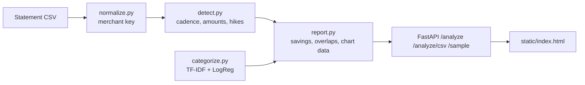

# Subscription Sniffer


Most people cannot say what they pay for every month. Subscription Sniffer reads a bank statement and answers three questions: **what recurs, what got more expensive, and how much do I save if I cancel?**


## What it finds
| Finding | Example from the bundled statement |
|---|---|
| Recurring charges and their billing period | weekly meal box, monthly streaming, quarterly VPN, yearly domain |
| Price rises | Streambox 12.99 to 15.99, costing 36.50 more a year |
| Services that already stopped | a game pass cancelled after 8 months |
| Fixed bills, kept apart from subscriptions | rent, energy, insurance |
| Overlaps | two streaming services at once |
| Savings if you cancel | tick a row; the tally at the bottom updates |

## Try it
```bash
python -m venv .venv && source .venv/bin/activate && pip install -r requirements-dev.txt
python scripts/generate_data.py                 # data/ is already committed; this rebuilds it
PYTHONPATH=src python -m sniffer.train          # category model + detector scores
PYTHONPATH=src uvicorn sniffer.api:app          # http://localhost:8000
pytest -q && ruff check .
```
Docker: `docker build -t subscription-sniffer . && docker run --rm -p 8000:8000 subscription-sniffer`. Hosting: [DEPLOY.md](DEPLOY.md). Upload your own CSV with columns `date,description,amount` (money out negative). The file is processed in memory and never stored.

## How detection works
1. **Clean the description.** `POS 927 STREAMBOX`, `STREAMBOX*4821 LEEDS` and `CARD PAYMENT TO STREAMBOX 1234` all become `STREAMBOX`.
2. **Group by merchant, look at the gaps** between charges. A merchant is recurring if at least 80% of gaps fit weekly (7±2 days), monthly (30±4), quarterly (91±7) or yearly (365±12), with a minimum charge count for each.
3. **Check the amounts.** Subscriptions charge the same amount, so most amounts must sit within 10% of the median. Groceries and coffee fail step 2 or 3.
4. **Spot price rises.** For fixed-price series only, a persistent step up of 3% or more is a rise, valued per year.
5. **Label it with a small ML model**: character n-gram TF-IDF with logistic regression guesses the category (streaming, fitness, utilities, ...). Housing, utilities and insurance become "fixed bills".



## How well does it work?
Scores on the synthetic statement (14 months, 484 transactions, ground-truth labels):

| Check | Result |
|---|---|
| Recurring-charge precision / recall | 1.00 / 1.00 |
| Category accuracy (3-fold CV, 278 invented merchant names) | 0.95 |
| Tests | 20 passing (cadences, hikes, noise, inactive, parsing, API) |

These numbers describe fabricated data built to contain the hard cases, not real bank feeds.

## Design decisions
- **Rules for detection, ML only for labels** — recurrence has a clear definition, so rules are testable and explainable ("7 of 8 gaps were 30±4 days"); ML is used where rules cannot work (naming a merchant's category).
- **Price rises only judged on fixed-price series** — a variable utility bill moves ±8% every month; flagging that as a rise would be wrong (covered by a test).
- **Bills and subscriptions are separated by category** — rent is recurring but not something you "cancel".
- **Overlap alerts only for comparable services** — two streaming services is a decision worth questioning; a VPN plus cloud storage is not.
- **Yearly charges need only 2 occurrences** — otherwise a 14-month statement could never reveal them.
- **Upload is parsed in memory, 2 MB cap, no storage** — financial data should not persist on a demo host.
- **Visual system dealt with taste-skill**: palette "charcoal-room-sage" (dark first, with a light set), Instrument Sans + DM Mono, ledger layout with a sticky savings tally.
- **Fictional merchants, seeded generator** — no real transactions; reproducible and licence-free (CC0).

## Dataset
`data/transactions.csv` (484 rows) and `data/merchants.csv` (278 names) come from `scripts/generate_data.py` (seed 5). All merchants and amounts are invented; no real person or bank.

## Limitations
- Real statements are messier: foreign currency, refunds, shared accounts, merchants that rename themselves.
- A new subscription with fewer than 3 charges (2 for yearly) is not detected yet.
- The category model learns from invented names with keyword cues, so unusual real merchants may be mislabelled.
- It never contacts your bank or cancels anything; it only reports.

## License
MIT.
