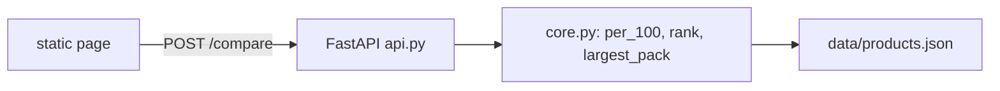

# Unit Price Checker


## Problem
Packs are labelled in kg, g, oz and lb, so "which is cheaper?" means doing unit conversion at the shelf. The biggest pack is often assumed to be the best value, and it often is not.

## Solution
Convert every pack to price per 100 g (or per 100 ml), rank them and show how much more each costs than the best. Sample (invented prices, rice): the 2 lb pack is best at 0.232 per 100 g, the 1 kg bag is 3.7% dearer, and the 5 kg sack (the biggest) is 16.6% dearer.

## Architecture


## Setup
```bash
pip install -r requirements-dev.txt
PYTHONPATH=src uvicorn unitprice.api:app --port 8000
PYTHONPATH=src pytest
docker build -t unitprice . && docker run -p 8000:8000 unitprice
```
Deploy: see [DEPLOY.md](DEPLOY.md) (Render or Hugging Face Spaces).

## Design decisions
- Normalise to grams or millilitres: one common base makes comparison a sort.
- Mass and volume are never mixed: it raises an error, since there is no density to convert with.
- Conversion factors in one table: easy to audit and extend.
- Price per 100 units: gives readable numbers for small items.

## Limitations
- Ignores quality, waste, loose versus packed weight and loyalty discounts.
- No count-based units (eggs, sheets).
- Prices are invented.

Data: invented, MIT licence.
