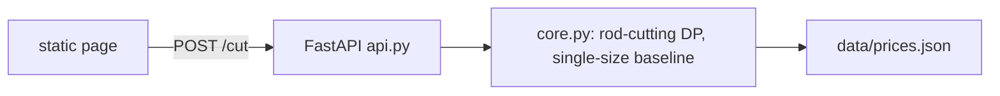

# Plank Cutting Planner


## Problem
A timber yard sells pieces at different lengths and prices. Cutting only the size with the best price per centimetre can leave a large offcut that could have been sold.

## Solution
Rod-cutting dynamic programming finds the cuts with the highest total value. Sample (240 cm plank; 30 cm $4, 50 cm $7.50, 80 cm $13, 90 cm $15.50):

| Plan | Pieces | Value | Offcut |
|---|---|---|---|
| Best cuts (DP) | 90, 90, 30, 30 | $39.00 | 0 cm |
| Best price per cm only | 90, 90 | $31.00 | 60 cm |

## Architecture


## Setup
```bash
pip install -r requirements-dev.txt
PYTHONPATH=src uvicorn plankcut.api:app --port 8000
PYTHONPATH=src pytest
docker build -t plankcut . && docker run -p 8000:8000 plankcut
```
Deploy: see [DEPLOY.md](DEPLOY.md) (Render or Hugging Face Spaces).

## Design decisions
- Exact DP over whole centimetres: optimal and instant (checked against brute force).
- Offcuts are worth nothing: keeps the model simple and conservative.
- Baseline is the price-per-cm rule: the intuitive shortcut that visibly loses.
- Stateless API, invented data: nothing personal stored.

## Limitations
- No saw-blade width (kerf) allowance.
- Prices are fixed; no demand limits per size.
- Plank length capped at 1000 cm.

Data: invented, MIT licence.
