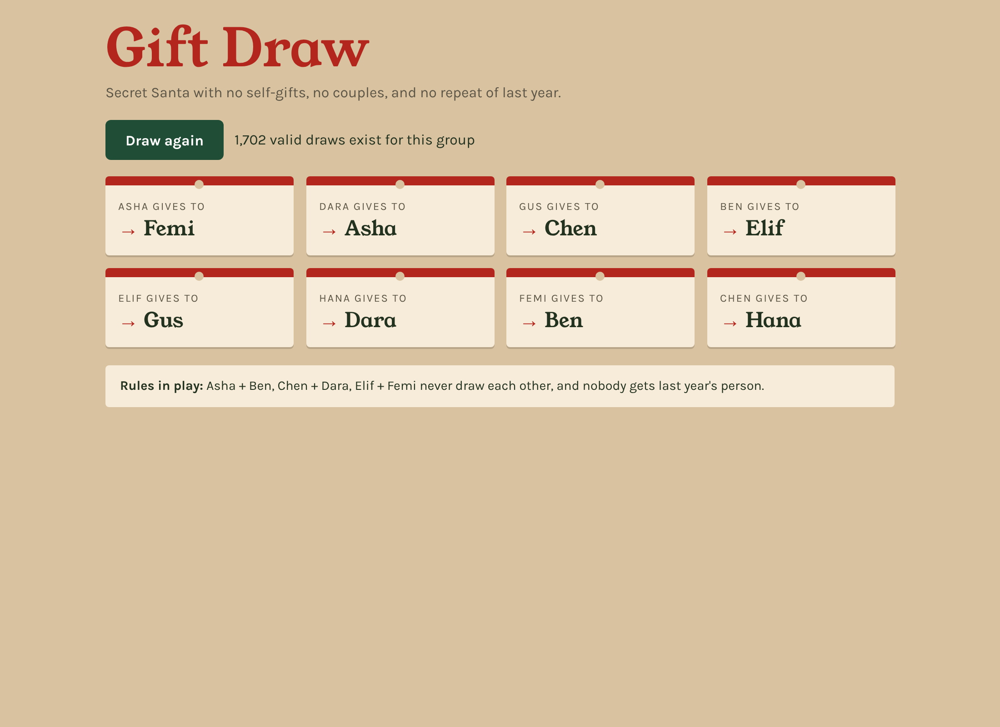
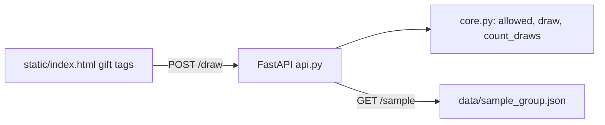

# Secret Santa Matcher ("Gift Draw")

A fair Secret Santa draw: nobody draws themselves, couples never draw each other, nobody repeats last year, and impossible groups are detected.



## Problem
Hat draws and naive shuffles either hand someone their partner or themselves, or loop forever re-shuffling when the rules are tight.

## Solution
The draw is a bipartite perfect matching (givers to receivers) over the allowed pairs, found with Kuhn's augmenting-path algorithm on a randomly shuffled adjacency list. It always terminates: it either returns a valid draw or proves none exists. A subset DP counts how many valid draws exist (1,702 for the sample group of 8).

## Architecture


## Setup
```bash
pip install -r requirements-dev.txt
PYTHONPATH=src uvicorn santadraw.api:app --reload   # http://localhost:8000
pytest -q && ruff check .
docker build -t santadraw . && docker run -p 8000:8000 santadraw
```
Endpoints: `GET /health`, `GET /sample`, `POST /draw` (optional `seed`). Deploy: [DEPLOY.md](DEPLOY.md).

## Design decisions
- Matching instead of shuffle-and-retry: retry loops can spin forever on tight rules; matching terminates and detects infeasibility.
- Shuffle the adjacency lists and the giver order: the draw is random and every valid draw is reachable (tested on a 4-person group: all 9 appear).
- Optional seed: reproducible tests and a way to re-run an agreed draw.
- Count draws with a bitmask DP and cross-check against brute force: shows how constrained a group is, and proves the rules are applied.
- Stateless, nothing stored: a real secret draw should not keep the result on a server.

## Limitations
- The demo UI shows every assignment on one screen, which defeats secrecy; a real deployment would reveal one name per person (e.g. unique links), which is not built.
- Names only, no emails or wish lists.
- Counting is limited to 12 people in the API (14 in code).

## Data
`data/sample_group.json`: invented first names; MIT with the repo.
