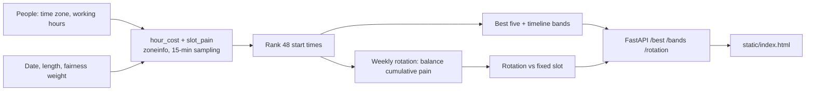

# Fair Meeting Time


*A weekly sync across Kolkata, São Paulo, Berlin, Sydney, Accra and New York.* There is no time that suits everyone, so someone is always the one who stays up. This tool finds the least painful slot, says plainly who pays for it, and **rotates the time week by week so the same people do not always pay**.


## Same team, two ways of scheduling
| Over 8 weeks (sample team) | One fixed best time | Rotating time |
|---|---|---|
| Most pain carried by one person | 496 (Ben, in Sydney) | 292 |
| Gap between most and least burdened | 496 | 284 |
| Meets in someone's sleep? | every week, same person | spread across weeks |

Pain is a unitless score: 0 inside working hours, rising with the square of the hours outside them, and 50 or more once a slot touches someone's sleep (more the deeper into the night).

## How it works
1. **Cost per person.** For every 15 minutes the meeting covers, the local time (with the real time-zone rules for that date, so daylight saving is respected) is turned into a cost. The meeting's cost for a person is the worst moment it touches.
2. **Rank every slot.** All 48 half-hour starts on a UTC day are scored by `total pain + λ × worst individual pain`. λ ("protect the worst-off") is a slider: 0 means purely minimise the total, higher means nobody should carry a disaster.
3. **Rotate.** For each week, take the 14 best slots and pick the one that keeps the largest cumulative pain, then the total, lowest. This is a greedy balancing rule, not an optimum, but it is fast and explainable.
4. **Compare** the rotation with simply using the best slot every week.



## Run it
```bash
python -m venv .venv && source .venv/bin/activate && pip install -r requirements-dev.txt
PYTHONPATH=src uvicorn meetfair.api:app          # http://localhost:8000, docs at /docs
pytest -q && ruff check .
```
Docker: `docker build -t fair-meeting . && docker run --rm -p 8000:8000 fair-meeting`. Hosting: [DEPLOY.md](DEPLOY.md). `tzdata` is a dependency because slim container images do not ship the time-zone database.

## Design decisions
- **A cost per person, not a yes/no "is it working hours"** — the interesting case is when nothing fits; a graded cost lets the tool choose between a 6:30 am start and a 2 am start.
- **Quadratic cost outside working hours** — one hour early is a nuisance, three hours early is a real imposition; squaring captures that without extra parameters.
- **Sleep is graded by depth** — a meeting at 22:30 is not the same as one at 03:00; a flat penalty made every option equally bad and the rotation useless (found while building).
- **Total plus worst-off blend with a slider** — averages hide a person who is always the loser; the slider makes the trade-off visible instead of burying it in the code.
- **Rotation is greedy on the largest cumulative pain** — optimal rotation is a harder problem; this rule is easy to explain to a team ("this week it is Ben's turn to have the good slot") and the numbers show it works.
- **Real time-zone rules via `zoneinfo`, 15-minute sampling** — handles daylight saving and meetings that cross midnight (tested).
- **Timeline per person in UTC** — the whole problem is one picture: the teal-green stripe is where everyone is awake.
- **Visual system dealt with taste-skill**: palette "cool-white-slate" (slate and teal, with a night set), Fraunces + Figtree, soft radius.
- **No accounts, no calendar access** — people and zones are inputs; nothing is stored.

## Dataset
`data/sample_team.json`: six invented teammates in six real time zones. No personal data. CC0.

## Limitations
- Working hours are the same every day of the week; part-time days, school runs and public holidays are not modelled.
- The rotation is a heuristic: it balances pain well but is not provably optimal.
- Pain weights are judgement calls; teams may value a late evening and an early morning differently.
- It suggests a time; it does not check anyone's calendar or send invites.

## License
MIT.
