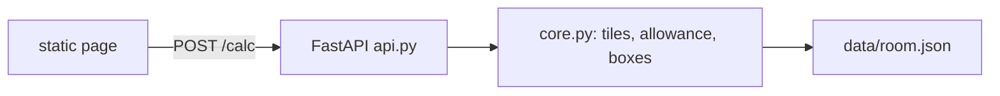

# Tile Box Calculator


## Problem
Tiles are sold in boxes, rooms need cut tiles at the edges, and some get broken. Buying exactly the floor area leaves the last row unfinished, and the shop may not have the same batch later.

## Solution
Count whole tiles (rows and columns rounded up), add a layout allowance (10% straight, 15% diagonal), then round up to whole boxes and report spares. Sample (3.6 x 4.2 m, 30 cm tiles, 11 per box, $38.50 a box):

| Plan | Boxes | Cost | Result |
|---|---|---|---|
| Diagonal with 15% allowance | 18 | $693.00 | 30 spare tiles |
| Straight with 10% allowance | 17 | $654.50 | 19 spare tiles |
| No allowance (168 tiles) | 16 | $616.00 | 18 tiles short of the diagonal need |

## Architecture


## Setup
```bash
pip install -r requirements-dev.txt
PYTHONPATH=src uvicorn tilebox.api:app --port 8000
PYTHONPATH=src pytest
docker build -t tilebox . && docker run -p 8000:8000 tilebox
```
Deploy: see [DEPLOY.md](DEPLOY.md) (Render or Hugging Face Spaces).

## Design decisions
- Round rows and columns up separately: tiles are not sold in fractions and edge cuts waste a tile each.
- Fixed 10% / 15% allowances: common trade rules of thumb, stated rather than hidden.
- Spares reported: they are worth keeping for repairs.
- Stateless API, invented numbers: nothing personal stored.

## Limitations
- Rectangular rooms only; no doorways, alcoves or pattern matching.
- Allowance percentages are rules of thumb, not measurements.
- Grout gaps are ignored.

Data: invented, MIT licence.
