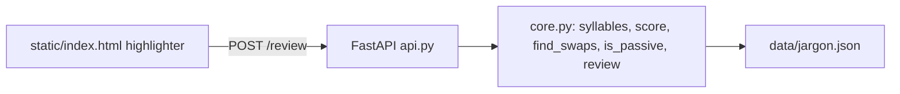

# Plain Words Checker

Paste a notice or email; get a readability score and highlights for hard words, passive voice and over-long sentences, with a simpler word suggested.


## Problem
Housing notices, school letters and clinic emails are often written in stiff, legal-sounding English that many readers struggle with. Writers rarely know how hard their text actually is.

## Solution
Score text with the Flesch reading-ease and Flesch-Kincaid grade formulas (using a vowel-group syllable heuristic), then flag per sentence: sentences over 25 words, passive constructions, and phrases from a plain-language swap list ("utilize" -> "use", "in order to" -> "to"). The sample notice scores 57 ("fairly hard", grade 9.8) with one 51-word sentence and ten suggested swaps; the plain rewrite below it scores much higher.

## Architecture


## Setup
```bash
pip install -r requirements-dev.txt
PYTHONPATH=src uvicorn plainwords.api:app --reload   # http://localhost:8000
pytest -q && ruff check .
docker build -t plainwords . && docker run -p 8000:8000 plainwords
```
Endpoints: `GET /health`, `GET /sample`, `POST /review`. Deploy: [DEPLOY.md](DEPLOY.md).

## Design decisions
- Standard Flesch formulas: widely understood, so a reviewer can sanity-check any score by hand.
- Heuristic syllable counter, no dictionary: keeps the app dependency-free; tests allow +/-1 syllable on tricky words and pin exact values for simple ones.
- Swap list in JSON with longest-phrase-first matching: "in order to" must win over "in", and editors can extend the list without code.
- Word-boundary matching: "terminator" must not trigger the "terminate" swap (tested).
- Highlight in the UI, not a rewrite: the tool shows what to change; it does not guess meaning for the author.

## Limitations
- Passive detection is a regex ("to be" + past participle), so it misses some cases and can flag adjectival uses.
- English only; the swap list is small and original, not a full style guide.
- Flesch scores suit short everyday text, not technical or poetic writing.

## Data
`data/jargon.json`: an original hand-written swap list in the spirit of public plain-English guides; MIT with the repo. The sample text is invented.
