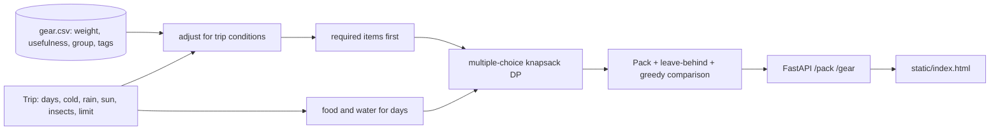

# Trail Pack Optimizer


Every hiker has stood over a pile of gear asking "do I really need this?" The usual answer is a rule of thumb, which is good until the weight limit is tight and the rule strands half your budget. Trail Pack Optimizer treats it as what it is, a **knapsack problem**, and solves it exactly.


## What you give it, what you get
| You say | It decides |
|---|---|
| Days, coldest night, chance of rain, sun, insects | Which items are essential (rain jacket at 25%+ rain, insulation and a warm bag in the cold) and how useful each item is today |
| A carry limit in kg | The most useful set of gear that fits, with food and water for your trip length added on top |
| (nothing) | The weight split by category, the next items you left behind, and a curve showing what each extra kilo would buy |

## How it works
1. **Conditions adjust the catalogue.** Utilities move with the trip (a head net matters with insects and not without; a stove is worth less on a day hike). Essential items are fixed first.
2. **Consumables are added**: 650 g of food per person per day, and 1 L of water, 2 L when it is hot and sunny.
3. **The rest is a multiple-choice knapsack.** Dynamic programming over 10 g steps finds the highest total usefulness within the remaining budget. Items sharing a group (tents, sleeping bags, pads) are alternatives: at most one is taken.
4. **Check against a rule of thumb.** The same budget is filled greedily by usefulness per gram; the tests show cases where greedy strands budget and the exact answer wins (for example 10.0 against 6.5).
5. **Sensitivity.** The solver is re-run at nearby limits to draw "usefulness against limit", so you can see when an extra kilo stops paying off.



## Run it
```bash
python -m venv .venv && source .venv/bin/activate && pip install -r requirements-dev.txt
PYTHONPATH=src uvicorn packlist.api:app          # http://localhost:8000, docs at /docs
pytest -q && ruff check .
```
Docker: `docker build -t trail-pack . && docker run --rm -p 8000:8000 trail-pack`. Hosting: [DEPLOY.md](DEPLOY.md). Pure Python plus pandas; no model files.

## Design decisions
- **Exact DP, not greedy** — a pack is small enough (about 45 items, a few thousand 10 g steps) that the optimum costs milliseconds, so there is no reason to accept a heuristic that can strand budget.
- **Verified against brute force** — the tests enumerate every subset of small catalogues and compare totals with the DP, which is the evidence it is right.
- **Mutually exclusive groups** — one tent and one sleeping bag; without this the optimiser would happily carry three shelters.
- **Essentials are fixed before optimising** — safety kit that the conditions demand is a constraint, not something that should compete on usefulness with a paperback.
- **Food and water outside the knapsack** — they are not choices, they follow from days and heat; keeping them separate makes the weight bar honest.
- **Sensitivity curve instead of a single answer** — "what does one more kilo buy?" is the question a hiker actually asks.
- **Usefulness scores are explicit data** — in `data/gear.csv`, easy to disagree with and edit.
- **Visual system dealt with taste-skill**: palette "white-mint-tiles" (mint as a fill, ink for text, with a night set), Funnel Display + Funnel Sans, a tile board around a weigh-in bar.

## Dataset
`data/gear.csv`: 46 generic gear items with illustrative weights and usefulness scores written for this demo (no brands). CC0. Not safety advice: real trips need real planning.

## Limitations
- Usefulness scores are judgement calls, not measured; two hikers would score differently.
- One person's pack; shared group gear (one tent for two) is not split between people yet.
- Weights are per item, so a lighter model of the same item is a different catalogue row.
- It optimises usefulness under a limit, not comfort over a whole trip or the real mass of the terrain.

## License
MIT.
