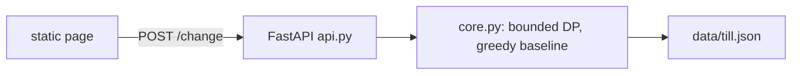

# Coin Change Maker


## Problem
A machine with a limited stock of coins must hand back change. Always giving the biggest coin first uses more coins than needed, and can even fail when exact change exists.

## Solution
A bounded coin-change DP finds the fewest coins within the stock. Sample till (ten 1s, four 10s, two 25s):

| Amount | Fewest coins | Biggest-first |
|---|---|---|
| 30 | 3 (3 x 10) | 6 (25 + 5 x 1) |
| 40 | 4 (4 x 10) | 7 |
| 55 | 4 (25 + 3 x 10) | 7 |
| 60 | 3 | 3 |
| 75 | 9 | 9 |

## Architecture


## Setup
```bash
pip install -r requirements-dev.txt
PYTHONPATH=src uvicorn changemaker.api:app --port 8000
PYTHONPATH=src pytest
docker build -t changemaker . && docker run -p 8000:8000 changemaker
```
Deploy: see [DEPLOY.md](DEPLOY.md) (Render or Hugging Face Spaces).

## Design decisions
- Each physical coin is one 0/1 item: handles stock limits exactly (checked against brute force).
- Greedy baseline shown beside the optimum: it is the habitual method and it visibly loses.
- Amounts capped at 10,000: keeps the DP instant.
- Stateless API, invented data: nothing personal stored.

## Limitations
- Whole-unit coins only.
- Does not rebalance the till for future customers.
- Large stocks make the expansion slower (fine at this scale).

Data: invented, MIT licence.
