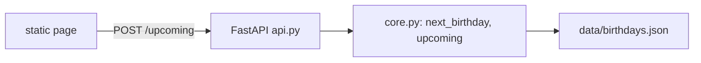

# Birthday Countdown


## Problem
A January-to-December birthday list does not tell you who is next. Leap-day birthdays and the year-end rollover make hand counting error-prone.

## Solution
For each person, find the next birthday on or after today, the days left and the age they turn, then sort soonest first. Sample (invented people, today 2026-11-17): Chloe today (turns 28), Dev in 13 days, Elif in 37, Ben (born 29 Feb) on 2027-02-28 in 103 days. A calendar-order list would start with Asha, who is 53 days away.

## Architecture


## Setup
```bash
pip install -r requirements-dev.txt
PYTHONPATH=src uvicorn bdaycount.api:app --port 8000
PYTHONPATH=src pytest
docker build -t bdaycount . && docker run -p 8000:8000 bdaycount
```
Deploy: see [DEPLOY.md](DEPLOY.md) (Render or Hugging Face Spaces).

## Design decisions
- 29 Feb birthdays fall on 28 Feb in non-leap years: keeps the celebration before March, a common convention.
- A birthday today counts as 0 days away: you still need to act today.
- `today` is an input, not the system clock: makes results testable and reproducible.
- Ties sort by name: deterministic output.
- Stateless API, invented data: nothing personal stored.

## Limitations
- Some people prefer 1 March for leap-day birthdays; this is not configurable yet.
- Dates are Gregorian only; no time zones.
- Names and dates are invented.

Data: invented, MIT licence.
