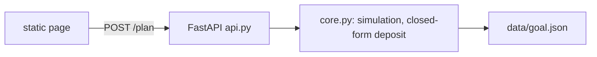

# Savings Goal Planner


## Problem
You want $5,000 by a date. How long will it take at your current saving rate, and what monthly deposit would get you there on time?

## Solution
Month-by-month simulation for "how long" and a closed-form annuity formula for "how much", with the two cross-checked in tests. Sample (goal $5,000, start $500, $150 a month, 4% a year, target 24 months):

| Question | With interest | Ignoring interest |
|---|---|---|
| Months to reach the goal | 29 | 30 |
| Monthly deposit to hit it in 24 months | $178.75 | $187.50 |

At 4% the effect is small, and the README says so: interest matters far more over long horizons.

## Architecture


## Setup
```bash
pip install -r requirements-dev.txt
PYTHONPATH=src uvicorn savegoal.api:app --port 8000
PYTHONPATH=src pytest
docker build -t savegoal . && docker run -p 8000:8000 savegoal
```
Deploy: see [DEPLOY.md](DEPLOY.md) (Render or Hugging Face Spaces).

## Design decisions
- Simulation for months, formula for deposits: the loop is easy to trust and the formula is checked against it.
- Deposits at month end, monthly compounding: a common, stated convention.
- Rate capped at 30%: catches typos like 4 instead of 0.04.
- Stateless API, invented numbers: nothing personal stored.

## Limitations
- Fixed rate, no inflation, tax or fees.
- Constant deposits; no raises or irregular saving.
- Not financial advice.

Data: invented, MIT licence.
