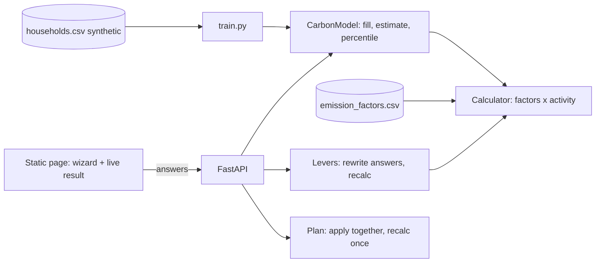

# Household Carbon Coach

> **One return long-haul flight is 1.5 tonnes of CO2e. In the worked example household of three (14.1 t a year), skipping it saves more than turning the heating down, recycling more and buying fewer clothes combined, about five times over.**

A two-minute questionnaire that turns home, travel, food and shopping answers into a yearly footprint, compares it with a typical household, and ranks the changes worth making by impact per effort.


## What you do / what you get

| What you do | What you get |
|---|---|
| Answer five short steps: home, electricity, getting around, food and shopping, waste | A yearly footprint in tonnes CO2e, live as you type |
| Skip anything you do not know (kWh, km, clothes, waste) | A model fills the gap and tells you what it estimated |
| Look at the footprint ribbon | Seven categories drawn to scale, with a tick for a typical household |
| Read the ranked lever list | Tonnes saved, an effort score (1 to 5), a cost and payback note, ordered by impact per effort |
| Click up to three levers into your plan | A second "after your plan" ribbon, with interacting levers counted once |

## How the numbers are made

**Factors x activity.** `data/emission_factors.csv` holds 33 labelled illustrative factors. `src/carbon/calculator.py` multiplies each by an answer, one small function per category: heating (floor area x demand per m2 x thermostat adjustment x fuel factor, or electricity / heat-pump COP), electricity (kWh x grid or green factor), getting around (car km by car type plus bus and rail km), flights (short and long return counts), food (diet factor per person, less for meat-free days), shopping (goods tier plus clothes items), waste (kg x residual/recycled blend).

**Interaction handling.** A lever rewrites the answers and the calculator is run again, so a saving can never exceed the categories the lever touches. A plan applies all chosen levers to the same answers before recalculating, so overlapping levers are counted once (shift 20% of car km to the bus, then go electric: you do not save the full electric-car amount on km that moved) and helpful pairs are credited properly (a green tariff also cleans a heat pump's electricity). The plan reports the interaction in tonnes.

**ML role.** The calculator is the main engine. A small scikit-learn layer is trained on a synthetic survey of 3,000 households (seeded, CC0) and does three jobs: (1) a ridge model fills any detailed answer you skip from the quick answers; (2) quantile gradient boosting gives a quick footprint estimate with an 80% band, widened by split-conformal calibration; (3) the per-person footprint is ranked as a percentile among the synthetic households.

### Held-out results (450 test households)

| Metric | Value |
|---|---|
| Footprint MAE (quick answers only) | 0.94 t (predicting the mean: 4.18 t) |
| Footprint R2 | 0.92 |
| 80% band coverage | 75% (mean width 2.9 t) |
| Imputer R2: electricity, car km, transit km, clothes, waste | 0.75, 0.72, 0.75, 0.82, 0.74 |

Coverage is a little under the 80% target on this test split. The labels come from the same calculator, so these numbers measure how well quick answers recover the full calculation, not how well the calculation matches real households.

## Architecture



Modules in `src/carbon/`: `schema`, `factors`, `calculator`, `levers`, `plan`, `synth`, `model`, `train`, `api`.

## Run it

```bash
pip install -r requirements-dev.txt
PYTHONPATH=src python -m carbon.train          # writes models/carbon.joblib and metrics.json
PYTHONPATH=src uvicorn carbon.api:app --port 8000
pytest -q && ruff check .
docker build -t carbon-coach . && docker run --rm -p 8000:8000 carbon-coach
```

Endpoints: `GET /health /factors /metrics /sample`, `POST /footprint /levers /plan` (send `{"answers": {...}}`; `/plan` also takes `lever_ids`, empty means "suggest three").

## Design decisions

- **Calculator first, ML second:** every number the user acts on is a visible factor x activity product; the model only fills gaps and gives context.
- **Levers are answer rewrites, not hand-typed savings:** savings stay consistent with the calculator and cannot exceed their category.
- **Plan recalculates once:** the only way to avoid double counting between levers that touch the same activity.
- **Effort score 1 to 5 with dot markers instead of a scatter chart:** a list reads in rank order and works at 320px.
- **Ribbon to scale with a typical tick:** shows proportion and distance from typical in one glance.
- **Percentile per person, not per household:** a family of five should not look worse than a single person for being five.
- **Conformal band widening:** raw quantile bands under-cover; a calibration split corrects it.
- **Plain copy, no verdicts:** categories are shown against a benchmark without praise or blame.
- **Visual system dealt with taste-skill: palette olive-on-bone, type epilogue** (Epilogue with JetBrains Mono for numbers), soft radius, dark token set added by hand.
- **Wizard left, sticky result right:** the answer you change and its effect stay on one screen; on phones the result leads and a bottom dock keeps the totals visible.

## Dataset and factor sources, limits

- `data/households.csv`: 3,000 synthetic households from `python -m carbon.synth` (seed 7), released under CC0. Labels are the calculator's output on the generated answers. It is not survey data.
- `data/emission_factors.csv`: **illustrative**, rounded from publicly available factor sets such as UK DESNZ and US EPA. They are not exact and not certified.
- `data/sample_household.json`: the worked example shown on first load.

## Limitations

- Factors are round illustrative numbers; use the tool to compare choices, not to report emissions.
- No services, public spending, pets, second homes or home-grown energy.
- Flights count whole return trips for the household; no cabin class or radiative adjustment choice.
- The ML model learned from synthetic households, so its estimates inherit the generator's assumptions.
- One country-neutral grid factor; real grids differ a lot.

## Deploy

See [DEPLOY.md](DEPLOY.md) for Render (`render.yaml`) and Hugging Face Spaces. MIT licensed.
